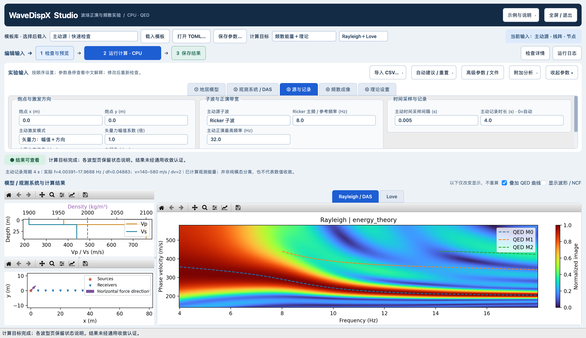
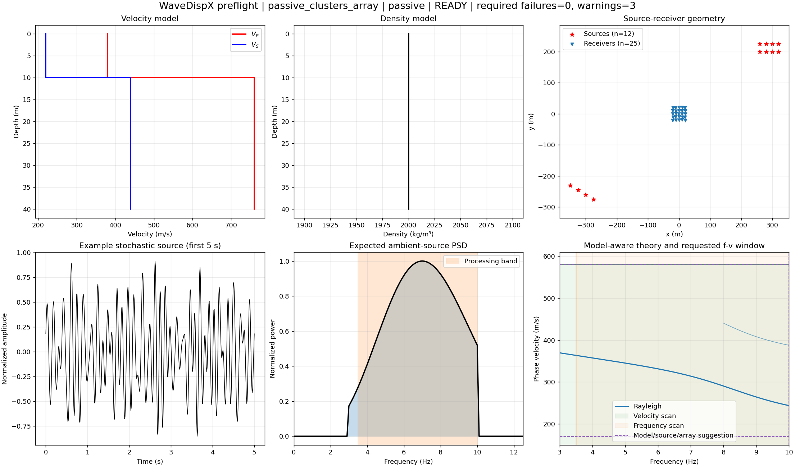
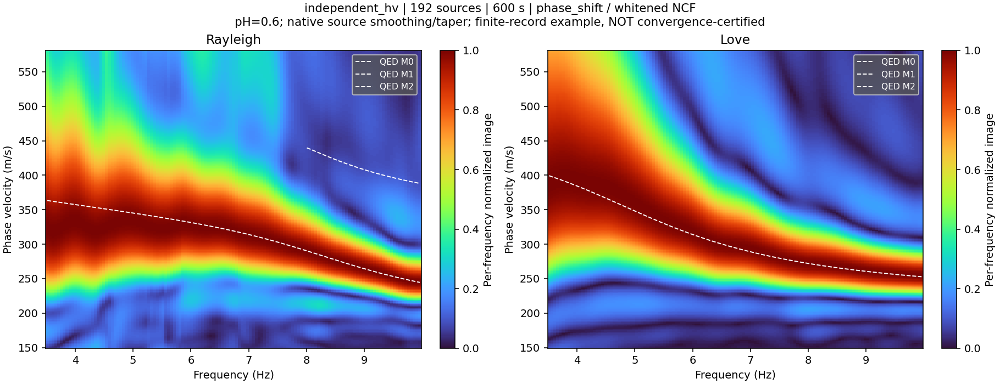
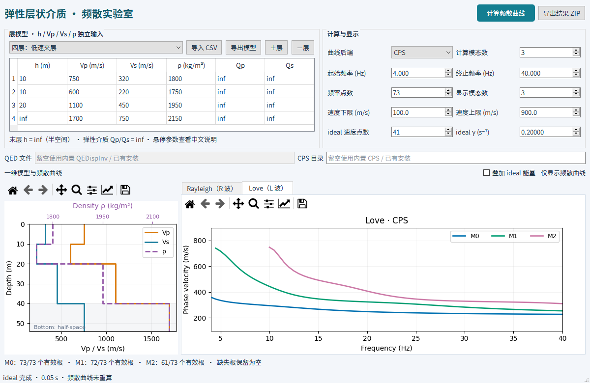

# WaveDispX｜波场正演与频散实验

从 **1D层状模型、震源与观测系统** 出发，模拟主动炮集或被动混合噪声，计算互相关与频散能量，并叠加 Rayleigh / Love 理论曲线。Python 组织实验，多线程 C++ 完成主要数值计算；Studio 使用原生 PySide6 界面，CPU 运行，无需 GPU。

**[Studio 下载](https://github.com/RunningXinLiu/WaveDispX/releases/tag/studio-2026.10.28-rc1)** · **[Studio 操作手册](docs/studio/README_zh.md)** · **[自定义台站与噪声源](examples/custom_geometry/README_CN.md)** · **[Notebook](notebooks/WaveDispX_workflow.ipynb)** · **[Classroom 下载](https://github.com/RunningXinLiu/WaveDispX/releases/tag/classroom-2026.10.27-rc1)** · **[反馈问题](https://github.com/RunningXinLiu/WaveDispX/issues)**

开发者主页：[runningxinliu.github.io](https://runningxinliu.github.io/) · 联系：[xinliu_geo@outlook.com](mailto:xinliu_geo@outlook.com)。软件左上角可直接打开主页；「关于」单独感谢 Pan Lei 的 [QEDispInv](https://github.com/pan3rock/QEDispInv)，并保留上游来源。

| 入口 | 适合做什么 | 如何获得 |
|---|---|---|
| **Studio 综合工作台** | 主动/被动、节点/DAS、Geometry、真实波形/NCF、R/L能量、可选HVSR | 四平台独立桌面试用包，亦可源码运行；见下文 |
| **Classroom 教学版** | 交互层模型、QED或CPS理论曲线、ideal频域响应 | 已有四平台教学试用包，见下文；不是Studio安装包 |
| **Notebook / Python API** | 分步骤修改输入、查看公式、编写可复现实验 | [Python/C++说明](README_PYTHON_CN.md)，新Studio产品请用对应实验接口 |

## Studio：输入、预览、计算、保存

普通可缩放窗口，面向16英寸笔记本布局，**不默认全屏**。模型、真实源台位置和计算结果同屏；参数按模型、观测系统、源与记录、成像、计算五组组织，提供中文悬停说明和字段错误定位。



上图是实际CPU运行截图，不是界面设计稿。保留有限孔径的宽峰、旁瓣和理论与能量的偏离；截图来自源分量验收阶段，最新第五页已增加CPU选项，见下图。

| 可配置项 | 当前功能 |
|---|---|
| 地层模型 | 层厚、Vp、Vs、密度、Qp/Qs；水平层状介质，不是横向非均匀2D/3D地下模型 |
| 观测系统 | 线阵、二维地表面阵、接收器/炮点CSV；主动一次选择一炮 |
| 主动源 | 子波、时长、采样、频率截断；垂直力或指定方位/倾角的矢量力 |
| 被动源 | 环带、线状、坐标CSV；PSD、随机种子、窗长/总时长、活动表；独立或定向H/V源功率 |
| 结果 | 仅理论、频散能量、能量+QED理论；Rayleigh/Love页分别说明不可计算原因 |
| 波形与NCF | 可选显示；炮集时间0在上，NCF横轴−T…+T、纵轴台间距 |
| DAS | 有限标距、光缆方向、应变/应变率；当前垂直源路径，Love-DAS未开放 |
| HVSR | 默认关闭；原始XYZ噪声H/V，单站、多站叠加、全台站热图；不是NCF谱比或理论椭圆率 |
| 计算资源 | CPU workers、频率/源分块，可保存到TOML；不是远程任务提交器 |


### 下载 Studio 桌面试用版

从[Studio Release](https://github.com/RunningXinLiu/WaveDispX/releases/tag/studio-2026.10.28-rc1)选择对应电脑的包：

| 平台 | 文件 | 打开方式 |
|---|---|---|
| Apple芯片Mac | `WaveDispX-Studio-macos-arm64.tar.gz` | 解压打开`.app` |
| Intel Mac | `WaveDispX-Studio-macos-x64.tar.gz` | 解压打开`.app` |
| Windows 64位 | `WaveDispX-Studio-windows-x64.zip` | 完整解压，双击`.exe` |
| Linux 64位 | `WaveDispX-Studio-linux-x64.tar.gz` | 完整解压运行同名程序；基线Ubuntu22.04 |

无需安装Python、Conda或编译器。保留完整目录，不能只复制exe；另下载`WaveDispX-Studio-guide-zh.zip`查看中文说明与平台验收记录。`SHA256SUMS.txt`用于核对下载完整性。默认普通窗口，不自动全屏。**目前未签名、未公证，仅为桌面试用版**，不要全局关闭系统安全保护。

四平台均完成8个小案例的实际GUI计算、数组对照与保存重读，以及默认主动兼容流程；这不是所有模型的科学收敛认证。[详细验收边界](docs/studio/PACKAGING_20261028_zh.md) · [安装与封装说明](packaging/studio/README_zh.md)。

### 从源码启动Studio

已有项目环境可直接运行 `sh scripts/launch_studio.sh`（该便捷脚本使用本机名为`seisloc`的Conda环境）。在其他机器上，使用自己的独立Python ≥3.11环境，从仓库根目录执行：

```sh
python -m pip install -e '.[desktop]' matplotlib
python -m wavedispx.desktop.studio --template examples/active_vector_studio.toml
```

首次安装需要C++17编译器；pip会构建原生核心。**源码运行的理论后端需另外准备，不包含在pip依赖中**：设置`QEDISPINV_FORWARD`为可执行文件绝对路径，或放到`.wavedispx-tools/QEDispInv/bin/forward`。固定源码与构建依赖见[原生后端构建说明](packaging/classroom/README_zh.md)，其中CMake的`forward`目标可单独构建；兼容流程的自动群速度估计还需配套群速度库，见[Python说明](README_PYTHON_CN.md)。缺少后端会明确报错，不静默换求解器。以上仅为源码启动方式；独立桌面包已包含这些运行组件，不需要执行本节安装命令。

1. 载入示例或打开TOML，修改模型与源台参数。
2. 点击「检查与预览」，核对模型、Geometry和提示；自动建议是可修改的候选值，不保证收敛。
3. 选择产品及Rayleigh/Love，点击「运行计算 · CPU」。
4. 切换结果Tab，按需显示波形/NCF或启用HVSR。
5. 分别保存参数和计算结果；载入新模板前先保存自己的参数。

### 自定义非均匀噪声源

提供[可直接复制的完整输入包](examples/custom_geometry/README_CN.md)：东侧单侧源＋线阵、东北/西南双簇源＋不规则面阵、双簇活动随时间切换。接收器与源坐标为`x_m,y_m`，单位米；活动表为`window_index,source_index,amplitude_multiplier`，索引从0开始，幅值倍数的平方才是功率倍数。



位置、方向和时间权重是不同输入。逐源不同力方向尚未提供；短记录/小孔径示例用于学习配置，不是收敛示范。[完整窗口、NCF与结果](docs/studio/custom_inputs_20261028/README_zh.md)可一起核对。

### 实际被动R/L结果与科学边界



该例使用192源、600秒真实有限混合记录，NCF谱白化后相移成像；不是用逐源理想互相关代替混合记录。图保留宽峰和波动，**未认证统计或数值收敛**。对应[模型、Geometry、PSD、双边NCF、输入与运行记录](docs/studio/windowed_20261028/README_zh.md)一并提供。

正演核在频率—波数域求解，再合成有限时间波形；Studio观测能量来自炮集/NCF，并不等于直接频域ideal响应。相移、FJ等方法的选择记录在配置中；截图不能混称为同一算子。理论曲线用于对照，不用于把能量“画到正确位置”。更多线程、长记录或更细df/dv都不自动保证正确或收敛。

本阶段用户试用确认无操作阻断。接口回归、实际算例和局限见[阶段收尾记录](docs/studio/RELEASE_20261028_zh.md)及[证据登记](docs/forward_workflow/EVIDENCE_REGISTER.md)。不支持/不激发/缺分量会保留解释；当前不声称Love-DAS、逐源方向、任意模型高阶或自动参数已全面验收。

## Classroom：轻量频散教学版

Classroom使用PySide6，可选择QEDispInv或原生CPS计算相速度曲线，按需叠加ideal频域响应。学生使用打包版无需安装Python、Conda、编译器或后端；下载后可离线使用。与Studio分开维护，既有教学版本和下载链接保持不变。

**[下载教学版](https://github.com/RunningXinLiu/WaveDispX/releases/tag/classroom-2026.10.27-rc1)** · **[中文安装与使用说明](docs/classroom/INSTALL_AND_USE_zh.md)** · **[教学版详细说明](docs/classroom/README_zh.md)**



### 教学版下载与安装

在 [Release 下载页](https://github.com/RunningXinLiu/WaveDispX/releases/tag/classroom-2026.10.27-rc1) 的 **Assets** 中选择对应软件包。公开下载不需要 GitHub 账号；`Source code` 是源码，不是可直接启动的软件。

| 电脑类型 | 下载文件 | 启动方式 |
|---|---|---|
| Windows，Intel / AMD 64 位 | `WaveDispX-Classroom-windows-x64.zip` | 全部解压，双击 `WaveDispX-Classroom.exe` |
| Mac，Apple M 系列芯片 | `WaveDispX-Classroom-macos-arm64.tar.gz` | 解压，打开 `WaveDispX-Classroom.app` |
| Mac，Intel 处理器 | `WaveDispX-Classroom-macos-x64.tar.gz` | 解压，打开 `WaveDispX-Classroom.app` |
| Linux，Intel / AMD 64 位 | `WaveDispX-Classroom-linux-x64.tar.gz` | 解压，运行 `WaveDispX-Classroom` |

请保留完整解压目录，尤其是 Windows / Linux 的 `_internal` 文件夹。界面中的“QED 文件”“CPS 目录”留空即可使用内置后端。另外下载 `WaveDispX-Classroom-guide-zh.zip`（中文说明与示例），即可获得离线 HTML 说明和三个模型示例。

当前版本是 **未签名的教学试用版（Pre-release）**，尚未做 Apple 公证。已在 Windows Server 2022、Ubuntu 22.04、macOS 14 Apple 芯片和 macOS 15 Intel 构建环境运行成品自检；不等于所有学生电脑、Win10/Win11 和旧系统均已验收。Windows ARM、32 位系统和 Linux ARM 暂无对应包。系统提示及具体安装步骤见[安装说明](docs/classroom/INSTALL_AND_USE_zh.md)。

## 五分钟开始第一次计算

1. 打开软件，选择“两层：软覆盖层”示例，或导入自己的 CSV 模型。
2. 选择一个曲线后端：**QEDispInv** 或 **CPS**。
3. 设置频率范围和模态数。例如 4–40 Hz、73 个频率点、3 个模态，表示计算 M0、M1、M2。
4. 点击“计算频散曲线”，通过 **Rayleigh / Love** 标签切换波型。
5. 如需观察背景响应，勾选“叠加 ideal 能量”。默认关闭，勾选后才计算，不改变已有曲线结果。
6. 点击“导出结果 ZIP”，保存模型、曲线 CSV、图件、配置和计算记录。

参数和表头提供中文悬停说明。层模型可直接编辑、增删有限层、导入和导出；固定参数区无需滚动。左图在同一深度剖面中显示 Vp、Vs、密度，速度与密度分别使用底部和顶部横轴；右图显示当前波型的频散曲线。

一次只计算所选后端。需要比较 QED 与 CPS 时，分别计算并导出，在外部对比结果。

## 模型格式

使用 UTF-8 CSV，按地表到地下排列，表头固定为六列，单位写在列名中：

```csv
thickness_m,vp_mps,vs_mps,density_kgm3,qp,qs
10,750,320,1800,inf,inf
inf,1700,750,2150,inf,inf
```

| 字段 | 含义 | 规则 |
|---|---|---|
| `thickness_m` | 层厚，m | 有限层 > 0；最后一层为 `inf`，表示半空间 |
| `vp_mps` | 纵波速度，m/s | 正数，且 Vp² > 4Vs²/3 |
| `vs_mps` | 横波速度，m/s | > 0，本版仅支持固体层 |
| `density_kgm3` | 密度，kg/m³ | > 0，例如 1800，而不是 1.8 |
| `qp`, `qs` | 纵波、横波品质因子 | 当前弹性教学版必须为 `inf` |

Vp、Vs、密度独立输入，不自动套用经验关系。示例模型：[软覆盖层](docs/classroom/two_layer.csv)、[低速夹层](docs/classroom/low_velocity_layer.csv)、[均匀半空间](docs/classroom/halfspace.csv)。

## ideal 图表示什么

ideal 图由 WaveDispX 层状介质刚度核独立计算：Rayleigh 使用单位地表竖直载荷的 VV 响应，Love 使用单位地表横向载荷的 TT 响应。显示响应模平方的逐频归一化 dB 图，并保存原始复响应及未归一化数组。

它是**频域受迫响应图**，不是将理论曲线展宽得到的示意图，也不是有限阵列实测波形的 FK 图。复频率参数 γ 会影响响应峰宽，不能当作材料 Q。显示模态数不控制 ideal 图的累加阶数；两种波型分别归一化，不能直接比较亮度来判断绝对能量大小。公式、归一化和适用边界见[教学版详细说明](docs/classroom/README_zh.md#三个计算产品)。

## 导出与课堂练习

结果 ZIP 包含所选后端的 R/L 曲线 CSV、模型、图件、配置、日志及来源记录；计算过 ideal 时还包含相应响应数组和图件。曲线 CSV 字段为 `frequency_hz,mode,phase_velocity_mps,backend`。缺失根保留缺失值，不跨截止频率补线。

可以从以下练习开始：改变覆盖层厚度观察频散变化；保持 Vp 和密度不变，只修改 Vs；增加计算模态数观察高阶截止；导入低速夹层，比较理论曲线与响应亮脊；用均匀半空间检查 Rayleigh 与 Love 的区别。

## 低速夹层：后端差异教学案例

新增 [四层低速夹层模型与实测结果](docs/classroom/low_velocity_demo_20261028/README.md)：可直接导入的 [teaching_model.csv](docs/classroom/low_velocity_demo_20261028/teaching_model.csv)、QED/CPS真实软件截图、QED/sdisp96/surfdisp96全频段对照与原始曲线。按说明设置1–60 Hz、355点、4个模态即可复现实测界面。示例同时保留默认搜索的漏根现象，以及加密sdisp96搜索后恢复结果的控制证据。

## 文档与开发

| 内容 | 入口 |
|---|---|
| 学生安装、操作、模型导入、导出和故障排查 | [安装与使用说明](docs/classroom/INSTALL_AND_USE_zh.md) |
| 教学版物理定义与界面行为 | [Classroom 说明](docs/classroom/README_zh.md) |
| 四平台成品验证、截图和测试边界 | [打包验证记录](docs/classroom/PACKAGING_VALIDATION_20261027_zh.md) |
| 原生后端编译与桌面打包 | [构建说明](packaging/classroom/README_zh.md) |
| 主动 / 被动波场、DAS 与研究工作台 | [Python/C++ 说明](README_PYTHON_CN.md) |
| 原始 MATLAB 程序与原作者说明 | [原始 Readme](Readme.txt) |
| 科学工作流与证据登记 | [正演工作流](docs/forward_workflow/WORKFLOW_zh.md) |

开发者可克隆本仓库，在独立 Python 环境中按构建说明准备依赖和编译核心，再启动 `python -m wavedispx.classroom.app`。打包依赖见 `packaging/classroom/requirements.txt`，原生构建配方见 `packaging/classroom/native/`，跨平台自动构建见 `.github/workflows/classroom-build.yml`。源码环境需要另外准备运行依赖；学生下载打包版即可。

Classroom 当前支持水平分层、各向同性、固体/固体、无耗散弹性介质的**相速度**计算。暂不提供群速度、反演、敏感核、有限 Q、流体层或各向异性计算。工作台的功能范围与课堂版不同，不能混用两者的支持范围或验证结论。

## 来源与许可说明

WaveDispX 延续本仓库原始 PassiveFW / MATLAB 程序的工作，原作者署名和参考文献保留于 [Readme.txt](Readme.txt)。教学曲线后端使用 [QEDispInv](https://github.com/pan3rock/QEDispInv) 和 Robert B. Herrmann 的 [Computer Programs in Seismology（CPS）](https://www.eas.slu.edu/eqc/ComputerProgramsSeismology/index.html)。研究使用时请同时遵循所用组件的引用要求。

仓库公开不代表全部代码采用同一种许可证。第三方原始声明、固定源码和 SHA256 清单位于 `packaging/classroom/vendor/`；本仓库尚未设置统一顶层许可证。QED 根 LICENSE 与部分源码头存在不同表述，旧 CPS 快照的版本授权说明仍待补齐，不能直接套用当前上游网页的许可证。具体来源、现有声明与待核对项见[第三方组件说明](packaging/classroom/THIRD_PARTY_zh.md)。
