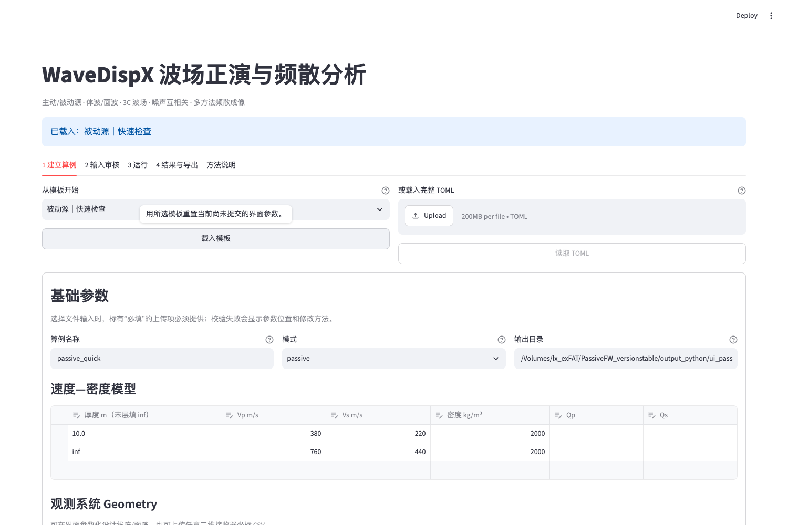
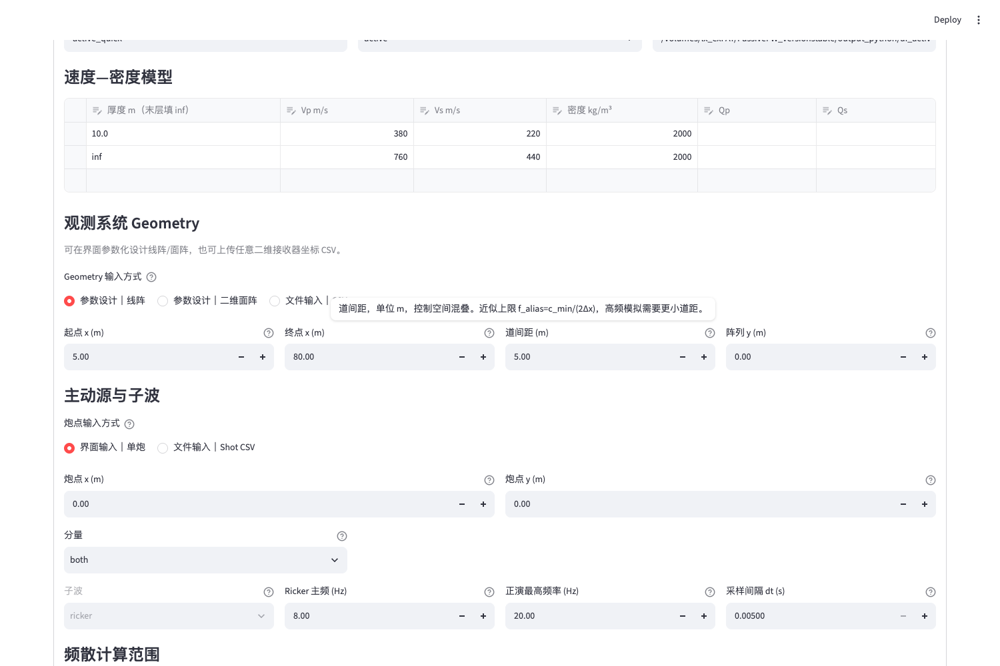
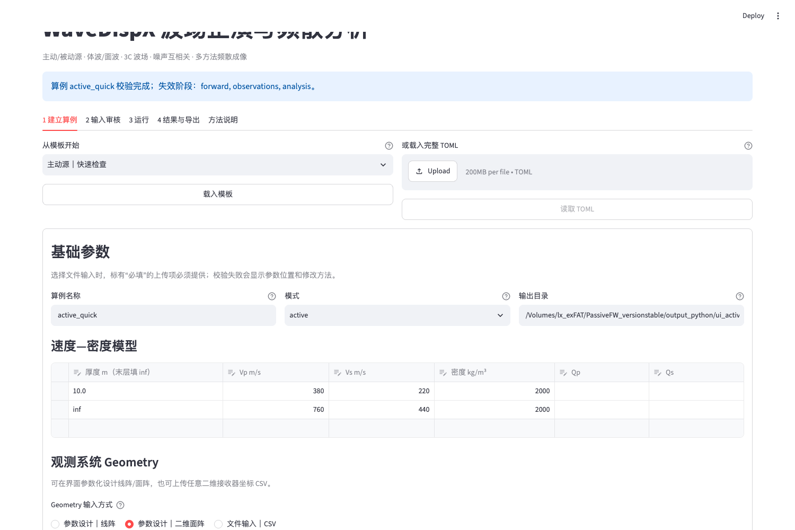
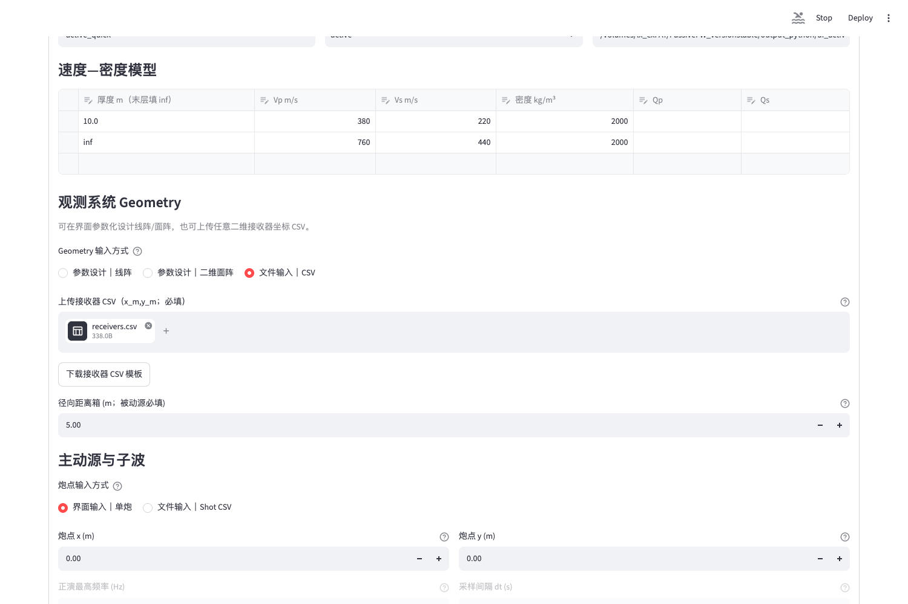
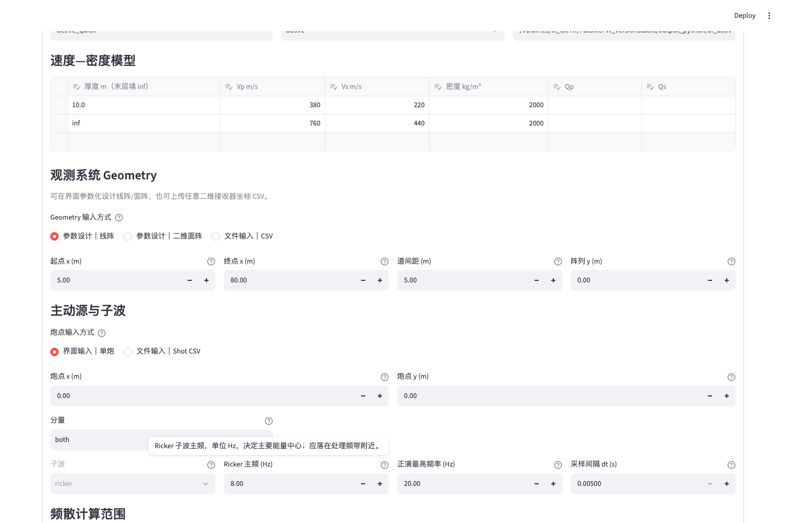
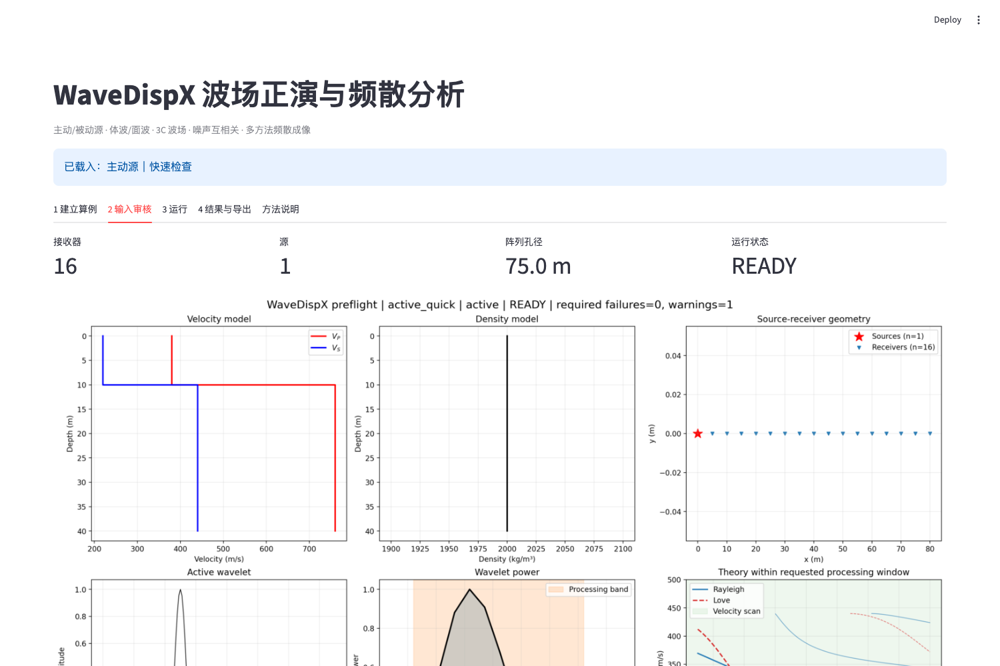
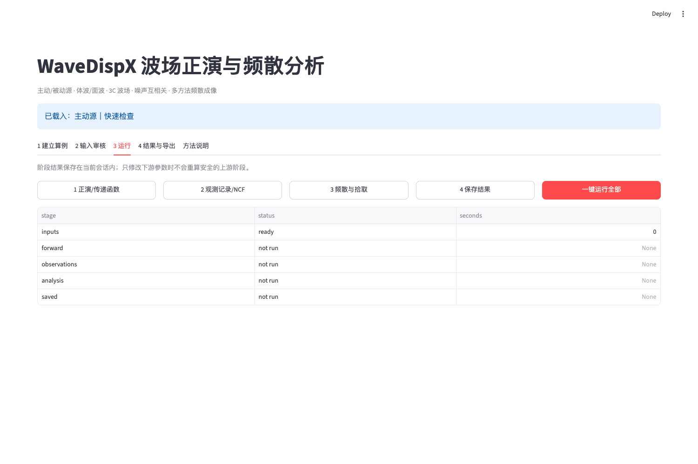
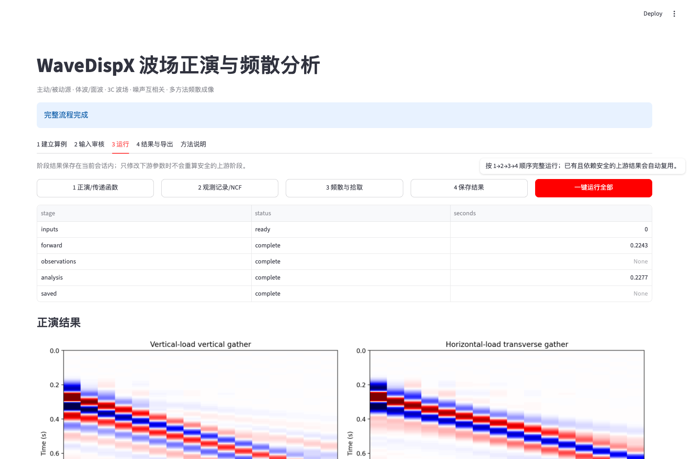
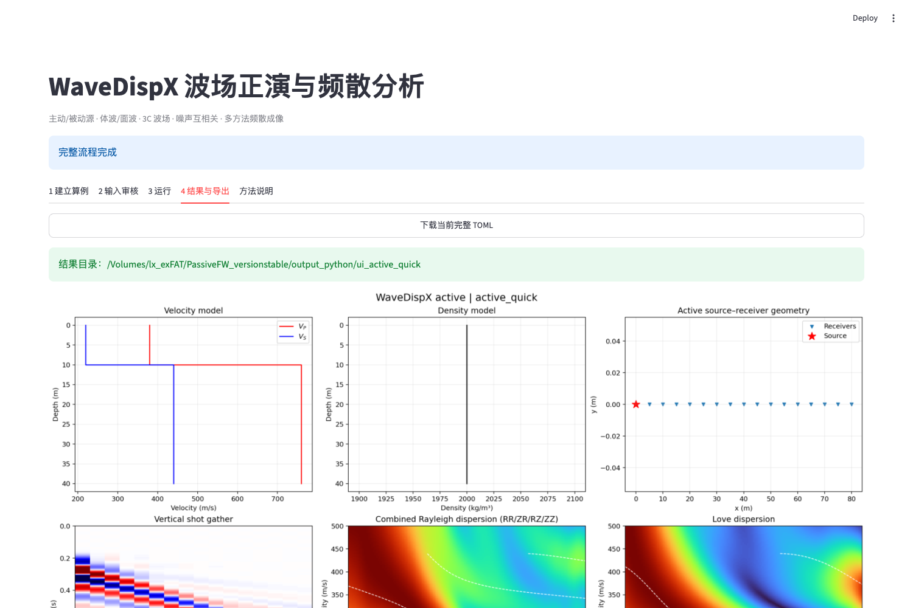

# WaveDispX 波场正演与频散分析界面手册

> 当前操作以 [新版完整操作手册](WaveDispX_USER_MANUAL_CN.html) 为准，包含自动推荐、重置、手动 df/dv 与波形时长/lag。本页和旧 HTML 保留为网页功能及历史四布局案例索引。

本界面把一个正演算例拆成“建立算例 → 输入审核 → 分阶段运行 → 结果导出”四步。参数可以在界面内逐项设计，也可以读取 TOML/CSV 文件后继续修改。所有参数标签右侧的 `?` 都有中文悬停说明；鼠标停在 `?` 上即可查看参数的物理意义、单位和使用建议。

## 1. 启动界面

在项目根目录运行：

```bash
conda run -n seisloc wavedispx-ui
```

浏览器会打开本机 Streamlit 地址。计算和数据均留在本机；关闭终端中的 Streamlit 进程即可停止界面。



页面顶部可选择：

- `active_quick / active_full`：主动源快速检查或正式算例；
- `passive_quick / passive_full`：被动源快速检查或较充分收敛算例；
- 上传 TOML：读取已保存的完整算例，并在界面中继续编辑；
- `算例名称` 和 `输出目录`：决定输出文件夹与结果标识。

模板只负责填入一套可运行的初值，不会自动开始正演。建议先选择最接近目标的模板，再修改模型、观测系统和源参数。

## 2. 中文悬停说明

每个可操作参数都带有中文 `hover tip`。例如，鼠标停在 `接收器间距` 右侧的 `?` 上，会说明它是相邻台站的空间采样间隔、单位为米，并提示其与空间混叠的关系。



悬停说明覆盖基础参数和高级参数，包括模型、Geometry、主动子波、被动噪声时序与 PSD、频散成像、并行与分块、相关归一化以及理论模态数。界面中的数值仍需根据研究尺度判断，说明文字不是自动选参器。

主动源另有 `主动记录时长 (s；0=自动)`：0 会按理论群速度、最大炮检距、处理最低频率及真实频率
分辨率自动设计；显式值过短会报出参数位置和建议最短时长。被动源要区分 `window_s`（传播覆盖与
单窗 df）和 `duration_s`（独立窗数与统计收敛）。审核理论图会在用户 f-v 裁剪窗外画完整源带内
多模态曲线，并以紫色虚线显示模型/源谱/阵列建议窗；FFT 补零不能替代真实时长。

## 3. 建立速度与密度模型

`分层模型` 表格每行代表一层：

- `厚度`：有限层厚度；最底部半空间不需要继续增加界面深度；
- `Vp / Vs`：纵波和横波速度，单位 m/s；
- `密度`：kg/m³；
- `Qp / Qs`：纵、横波品质因子，用于控制衰减。

可直接改单元格、增加行或删除行。点击“校验并绘制输入”后，输入审核页会画出 `Vp`、`Vs` 和密度随深度的阶梯模型；不要只凭表格判断模型是否正确。

## 4. 设计或输入接收器 Geometry

在 `Geometry 输入方式` 中可以选择三种方式。三者最终都会转成明确的二维 `(x_m, y_m)` 接收器坐标，因此后续正演与处理使用的是同一套接口。

### 4.1 参数设计：线阵

选择 `参数设计｜线阵`，输入起点、终点、间距和固定的 `y` 坐标。适合常规一维测线和快速频散测试。


例如 `x=0–200 m、间距 5 m、y=0 m` 会建立 41 个接收器。终点与间距不整除时，以界面实际生成和审核图为准。

### 4.2 参数设计：二维面阵

选择 `参数设计｜二维面阵`，分别设置 x、y 方向的起止位置和间距。程序生成规则网格，适合检查面阵孔径和径向台站对覆盖。



`距离分箱宽度` 用于把二维或不规则台站对按台间距归并成径向虚拟道集。当前频散流程使用台站对距离，不保留方位各向异性；若研究方向性，需要在外部按方位扇区分组后分别计算。

### 4.3 文件输入：任意二维 CSV

选择 `文件输入｜CSV` 后上传接收器文件，也可以先下载界面提供的模板。



文件格式：

```csv
x_m,y_m
0.0,0.0
5.0,0.0
```

坐标必须是有限数且不能重复。被动模式下还需填写 `距离分箱宽度`。上传文件在保存结果时会复制到输出目录，`input.toml` 使用相对路径，便于整包移交。

### 4.4 把节点接收器切换为 DAS

选择 `DAS｜主动线阵快速检查`、`DAS｜主动面阵快速检查`、`DAS｜被动线阵快速检查`、`DAS｜被动面阵快速检查` 或逐道光缆模板后，
参数树会出现 `DAS 光纤与测量算子`。每个字段都有中文 hover tip：

- `启用 DAS`：打开有限标距端点正演；
- `DAS 几何方式`：统一标距/方位，或逐道光缆 CSV；
- `标距 Gauge length`：仪器空间平均长度，不是道间距；
- `DAS 输出量`：轴向 `strain` 或 `strain_rate`；
- `光纤方位角`：相对全局 +x 轴逆时针，决定水平位移投影。

点击 `校验并绘制输入` 后，Geometry 图会同时显示接收器中心和橙色标距段/端点；必须在这里确认
标距方向、端点是否落到炮点/噪声源上，以及面阵是否符合“各中心处平行标距”的预期。输入错误卡会
直接定位到 `das.*`，并说明需要改标距、源分量、成像方法还是方法对照开关。

DAS v1 的界面会要求竖直源、`phase_shift` 和关闭三方法对照。这个限制是验证边界，不是 UI 缺项；
当前不能把节点 ZZ 的 FJ/Hankel 核当成 DAS 核。完整原理和可运行结果见
`notebooks/04_das_active_passive.ipynb`。

逐道真实光缆可在桌面版点击 `DAS 光缆 CSV`，网页版本则把 Geometry 切换到“文件输入｜CSV”、打开 DAS 并把 `DAS 几何方式` 设为“逐道光缆 CSV”。文件至少含 `x_m,y_m`，再提供四个端点列，或者逐道 `gauge_length_m,fiber_azimuth_deg`。输入审核图会逐段显示真实转弯方向；保存后生成可直接复用的 `das_channels.csv`。

## 5. 设置主动源或被动噪声源

### 5.1 主动源

模式选为 `active` 后，可直接设置单炮 `(x, y)`，也可上传 `shot_id,x_m,y_m` Shot CSV 并从多炮表中选择本次运行的炮点；随后设置激发分量、Ricker 或理想单位脉冲时间函数、主频/参考频率、最高计算频率和时间步长。`unit_impulse` 仅用于合成宽频系统校准。当前核心一次运行一炮，所选坐标会固化进输出 TOML。



- `主频` 决定子波谱峰；
- `最高计算频率` 决定正演频带上限，应覆盖所需能量但满足数值采样；
- `时间步长` 影响时域输出采样；
- `激发分量` 决定主要耦合的波型。

### 5.2 被动噪声源空间分布

被动源支持：

- `参数设计｜源环`：设置源数、半径范围和方位范围；
- `参数设计｜源线`：在指定线段上布源；
- `文件输入｜CSV`：上传任意 `(x_m, y_m)` 源坐标，并可下载模板。

源环适合做近似各向均匀照明；源线和 CSV 适合测试强方向性或真实先验分布。空间源数只控制照明采样，不等于记录中相互独立的时间片数量。

`被动源分量` 有两种稳定选项：

- `vertical`：只计算 Fz→Z，速度和内存最省，兼容既有 Rayleigh 流程；
- `three_component`：每个源激发独立 Fx/Fy/Fz，经 RR/TT/ZR/RZ/ZZ 五分量 Green 张量传播，
  接收端保存 X/Y/Z；线阵或面阵再按台站对方位形成 RR/TT/ZZ NCF。

高阶 Rayleigh 研究推荐从 `three_component` 开始，因为部分高阶可能主要耦合在 RR，而 ZZ 中几乎不可见。

### 5.3 被动噪声时间模型与 PSD

界面可设置记录时长、相关窗长、频带、随机种子、源振幅、独立源开关和泊松事件率。PSD 支持界面参数化频带，也支持 `frequency_hz,power` CSV：

```csv
frequency_hz,power
3.0,0.1
8.0,1.0
18.0,0.0
```

程序先按每个噪声源的 Green 传递函数生成有限时长随机记录，再把所有源贡献叠加到每个接收器；随后对接收器记录分窗并做接收器—接收器互相关/互谱叠加。它不是把“理想逐源 Green 相关”直接当成观测记录。`independent_sources` 打开时，各源使用独立随机实现；时间种子保证算例可复现。

`stationary_gaussian` 是整个窗内连续存在的带限随机过程，没有离散激发时刻；
`poisson_ricker` 会为每个源、每个窗生成 Poisson 数量的随机事件。Poisson 正式运行额外输出
`noise_events.csv`，可逐个核对源坐标、窗内时刻、绝对时刻、极性和权重。

完整的 receiver/shot/noise location 文件输入例子和实际 Geometry 图见
[HTML 手册第 4–5 节](WaveDispX_UI_MANUAL_CN.html#file-survey)。

## 6. 设置频散计算参数

常用字段包括分析频带、相速度范围、速度采样和成像方法：

- `phase_shift`：对距离道集做相位补偿与叠加，主动和被动 NCF 都可用；
- `hankel/FJ`：基于柱面波 Hankel/FJ 关系，更适合径向波场或主动源对照；
- 勾选“三方法对照”会在同一网格输出 phase-shift、Bessel(FJ)、Hankel 三张图；
- 速度范围必须覆盖预期基阶与高阶模态；
- 频率范围必须同时落在源 PSD、接收器采样和数值正演的可靠频带内。

`高级计算参数` 中可设置 CPU workers、频率/源分块、径向 Green 插值、是否保存逐源响应、相关归一化、FFT 补零、拾取最小能量，以及 Rayleigh/Love 理论模态数。首次使用建议保留模板值，在稳定基线后逐项做敏感性测试。

高阶模态的完整可运行模板为 `active_high_modes_3c.toml` 和 `passive_high_modes_3c.toml`。
它们同时保存分量图与方法对照图；增加源数或时长只能降低随机误差，不能改变模型本身的模态耦合强弱。

## 7. 校验并审核输入

完成参数后点击 `校验并绘制输入`。程序只建立和检查算例，不会偷偷启动正演。切换到 `2 输入审核`，必须检查六联图：

1. `Vp/Vs` 分层模型；
2. 密度模型；
3. source–receiver Geometry；
4. 主动子波或被动随机源样例；
5. 子波功率或噪声 PSD；
6. 理论 Rayleigh/Love 曲线与请求的频率—速度窗口。



下方检查表中：

- `required` 失败会锁住运行按钮，必须返回修改；
- `warning` 表示可运行但应人工判断，例如源数偏少、方位覆盖不足、孔径或记录时长偏小；
- `READY` 表示必需输入通过，不代表该算例一定达到研究所需的统计收敛性。

## 8. 分阶段正演或一键运行

切换到 `3 运行`。界面显示四个阶段及其状态：

1. `运行正演`：计算主动炮集，或被动源到接收器的 Green 传递函数；
2. `生成观测`：主动源生成记录；被动源合成有限时长混合噪声并计算 NCF；
3. `频散分析`：计算频散能量、理论曲线、拾取和质量指标；
4. `保存结果`：写出图、HDF5、CSV、TOML 和 manifest。



第一次建议逐阶段运行，便于定位问题。流程熟悉后可点击 `一键运行全部`；它执行完全相同的四个阶段，并按依赖关系复用当前会话内仍有效的结果。



如果返回上游改了参数，界面会将受影响的下游阶段标为失效；应从最早失效阶段重新运行，而不是沿用旧频散结果。

## 9. 查看和导出结果

切换到 `4 结果与导出`。完整结果图同时展示模型、Geometry、波形/NCF 道集、频散能量、理论曲线和拾取，方便判断“输入是否与结果属于同一个算例”。



可下载或移交的主要文件包括：

- `input.toml`：可复现的完整输入；
- `results.h5`：波形、NCF、频散能量等大数组；
- `dispersion_picks.csv`：拾取曲线；
- `convergence.csv`：被动源收敛指标；
- `manifest.json`：文件、参数和运行信息；
- 汇总 PNG：模型、Geometry 与完整计算结果。

HDF5 通常较大，界面显示其本机路径，不强制把整文件装入浏览器内存。

## 10. 方法与适用范围

`5 方法说明` 给出正演、有限时长噪声、NCF、phase-shift、Hankel/FJ 与理论频散的公式和实现边界。


当前重要限制：二维面阵和不规则阵列最终按台站对距离做径向平均，适合各向同性层状介质的频散分析；它不是完整三维各向异性反演。理论曲线来自输入的水平层状模型，用作计算窗口和结果的物理对照，不参与伪造能量脊。

## 11. 推荐的实际操作顺序

1. 选择模板或上传 TOML；
2. 编辑 `Vp/Vs/ρ/Q`；
3. 设计线阵/面阵，或上传接收器 CSV；
4. 设置主动炮点/子波，或被动源空间分布、PSD 和时间模型；
5. 设置频率—速度窗口和频散方法；
6. 点击 `校验并绘制输入`；
7. 在输入审核页确认六联图和检查表；
8. 首次逐阶段运行，稳定后使用 `一键运行全部`；
9. 在结果页核对完整图，并保存 `input.toml + manifest + HDF5 + CSV`。

被动结果不连续时，优先检查源方位覆盖、独立源数、有效窗数、记录时长、阵列孔径、最小/最大台间距和 PSD 频带，而不是只增加颜色平滑。快速被动模板用于验通流程；需要稳定收敛时，建议从 192–384 个方位分层源和 600–1800 s 记录起步，再用 `convergence.csv` 判断继续增加源数或时长是否仍有明显收益。
