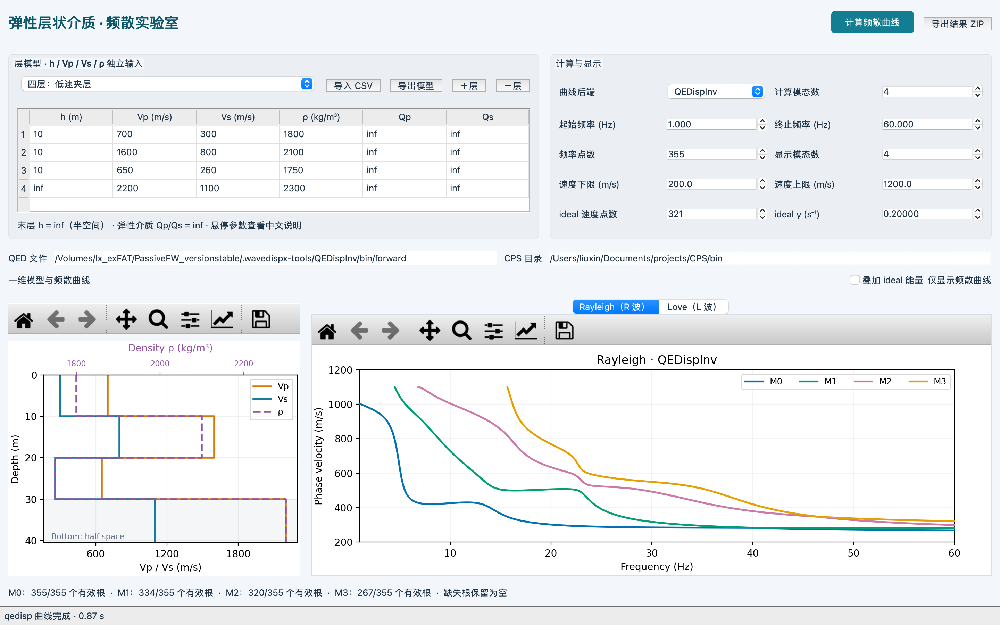
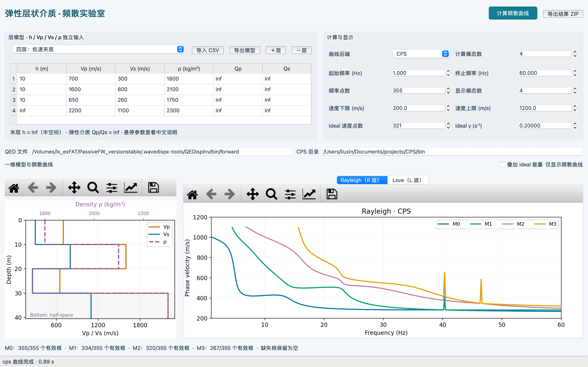
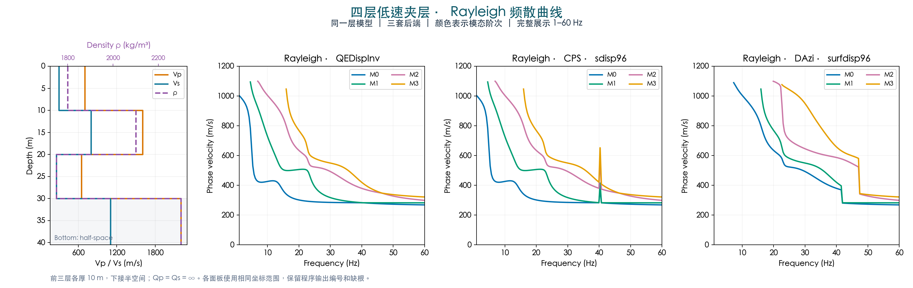

# 四层低速夹层：QEDisp、sdisp96 与 surfdisp96 对照

这是 2026-10-27 至 28 日按教学目的设计和实际计算的例子。模型可直接导入 WaveDispX Classroom；本目录包含真实软件窗口截图、三方曲线和独立验根记录。软件安装包仍使用仓库现有 Release，本次发布的是示例结果，没有修改求解器或重新发布应用。

## 下载模型并复现软件截图

下载 [teaching_model.csv](teaching_model.csv)（打开文件后点 **Raw / Download raw file**），在软件中点击“导入 CSV”。文件名是 **teaching_model.csv**，不是 teaching control.csv。

| 层 | 厚度 m | Vp m/s | Vs m/s | 密度 kg/m³ |
|---|---:|---:|---:|---:|
| 1 | 10 | 700 | 300 | 1800 |
| 2 | 10 | 1600 | 800 | 2100 |
| 3 | 10 | 650 | 260 | 1750 |
| 4 | 半空间 | 2200 | 1100 | 2300 |

各向同性、平面、固体弹性层，Qp=Qs=∞；Vp/Vs/密度独立输入，不用材料经验关系换算。

1. 起始频率 **1 Hz**，终止频率 **60 Hz**，频率点数 **355**。
2. 计算模态数和显示模态数均设 **4**，表示 M0–M3。
3. 速度显示范围 **200–1200 m/s**，ideal 保持关闭，查看 **Rayleigh** 页。
4. 分别选择 **QEDispInv** 和 **CPS**，各点击一次“计算频散曲线”并导出。

截图来自本机当前开发版真实 PySide6/Cocoa 窗口，直接捕获窗口内容，没有重绘截图；不是重新验收全部平台发行包。

### QEDispInv 实际运行

### 原生 CPS 实际运行

在这一355点等距轴上，约 **40.3333 Hz** 的基阶返回值：QED **282.6012 m/s**，CPS **376.9563 m/s**，同编号差 **94.3551 m/s**。CPS 的 M3 在约46.5 Hz还有跳点。缺根原样保留，不能仅凭曲线连续判定所有根正确。

原软件导出：[QED 结果 ZIP](gui/qedisp_result.zip) · [CPS 结果 ZIP](gui/cps_result.zip)。两个ZIP都包含R/L数组；这里重点讨论Rayleigh，不推断Love具有同样问题。二进制哈希和实际轴在 [GUI运行记录](gui/gui_report.json) 和 [原始数组](gui/gui_arrays.npz)。

## 完整频段的三方对照

[矢量 PDF](full/three_backends_full.pdf) · [三方曲线 CSV](full/curves.csv) · [精确输入](full/final/cases.json)

本图以软件配色区分模态，三面板坐标相同，保留返回编号、跳点和缺根。这里的第三方是原 DAzi 嵌入式 **surfdisp96**，不是 disba，也不是教学软件里的原生 **sdisp96**。软件仍只有QED/CPS两个可选backend；第三方为独立驱动计算。

三方审计采用1–60 Hz的151个等距点，另加原先定位的40.30、40.3166667、40.3333333 Hz，其中一个与等距轴重合，去重后共153点，统一float32舍入。它与上面的355点GUI轴不同，不能混用频点计数。surfdisp96收到完整的升序周期向量，没有切段或用旧窗口结果拼接。全部精确输入和输出见文件，不跨缺失值补线。

## 差异的含义与搜索参数控制

在39–41.5 Hz、151点的原始窄频段审计中，约40.30 Hz得到：

| 程序 | M0 m/s | M1 m/s | M2 m/s | M3 m/s |
|---|---:|---:|---:|---:|
| QEDisp forward | 282.6329 | 282.6531 | 377.1872 | 414.7524 |
| sdisp96 默认 FACR=5 | 377.1872 | 414.7524 | 585.1785 | 652.0182 |
| 原DAzi surfdisp96 | 377.1875 | 414.7524 | 585.1789 | 652.0182 |

较低的两个根被漏过后，返回编号发生偏移。因此约33%的基阶同编号差不能解释为同一物理模态的速度精度误差。

| 原生 sdisp96 设置 | 基阶明显偏离频点数 /151 |
|---|---:|
| FACR=5，默认 | 3 |
| FACR=20 | 1 |
| FACR=100 | 0 |

**FACR=100恢复本例全部604个返回值，与QED最大差约0.0000536 m/s。** 本例支持“QED在这组近邻根上比默认sdisp96搜索更稳健”，不支持“所有CPS设置都失败”或“QED全模型完备”。FACR是搜索控制参数，不能与旧surfdisp96的固定dc步长混为一谈。原DAzi连续周期调用在该窄窗口全部151点同编号偏离；该统计不外推至完整频段。

证据：[窄频段三方曲线](narrow/curves.csv) · [FACR控制曲线](narrow/search_control.csv) · [统计与输入](narrow/report.json)。

## 独立验根及来源

独立P/SV波振幅匹配法施加自由表面零应力、层间位移/应力连续及半空间衰减条件，不调用QED/CPS频散函数。窄频段的两个低阶候选根共 **302/302** 通过，最大根差约 **4.972×10⁻⁵ m/s**。这确认候选根存在，不是全域根数完备性的证明，也不是对新增宽频带全部根的认证。

[检查结果](narrow/matching_checks.json) · [可复算脚本](narrow/verify_matching.py) · [对应数组](narrow/comparison.npz)。已有NumPy/SciPy环境下运行 `python narrow/verify_matching.py` 即可复核。

- QED：教学版QEDispInv forward，数值源码基线 `68ac095f29308cad3b84f2ac0d5ca335c2767082`。
- sdisp96：教学版 `sprep96 → sdisp96 → sdpsrf96` 原生链，不加 `-D`。Linux二进制及线程环境见 [来源记录](provenance/linux_native.json)；GUI本机二进制另记在gui_report.json。
- surfdisp96：原DAzi冻结Fortran子程序，源码SHA256 `e4c35ff35fd98046a0e4e05d78601aecbb38e7167d6e628c8c49174e2c322dce`，原样编译；驱动/二进制散列见narrow/report.json。文件头维护年份不冒充已核验的完整CPS发行版本号。

该模型经过36组粗筛和20组定向筛选，为有目的的教学反例，不是三算法总体成功率评测。所有图仅为理论相速度曲线，没有计算ideal能量、波形、有限阵列FK、敏感核或反演。原程序输出中的缺失均保留。

`MANIFEST.json`记录发布文件SHA256。导出包和真实截图保留运行时路径供来源追溯；路径需按各自电脑配置，不是学生应照填的安装位置。
