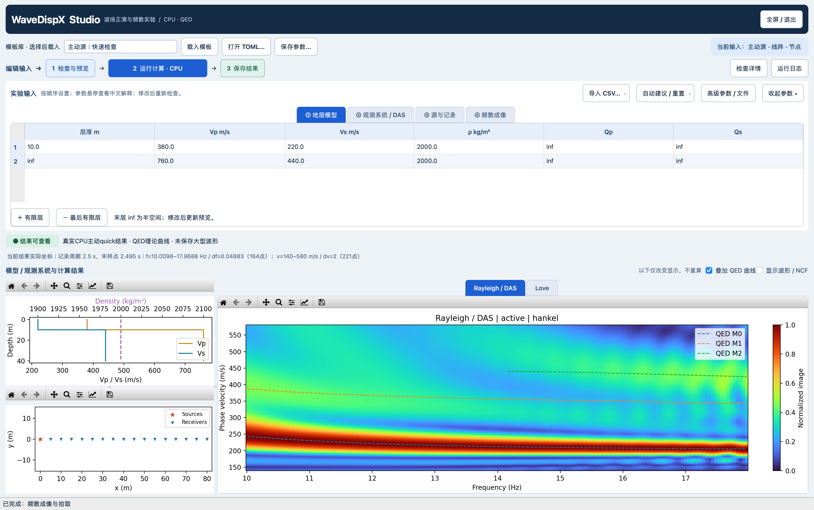
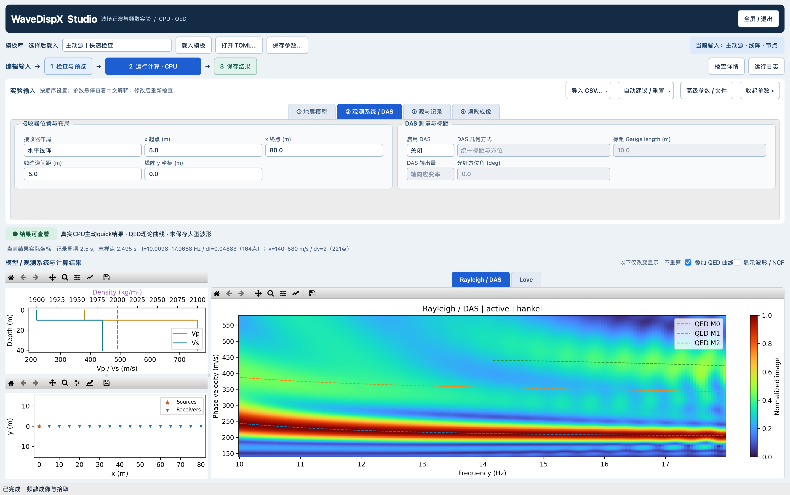
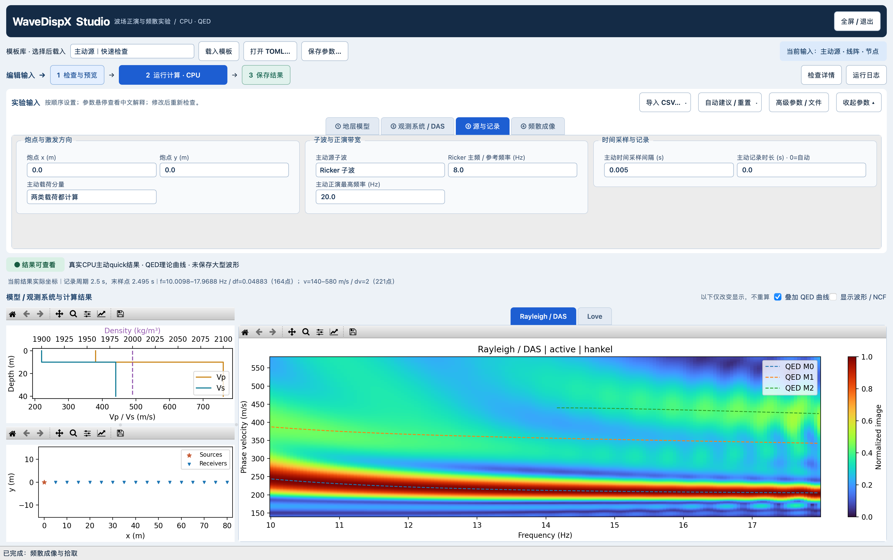
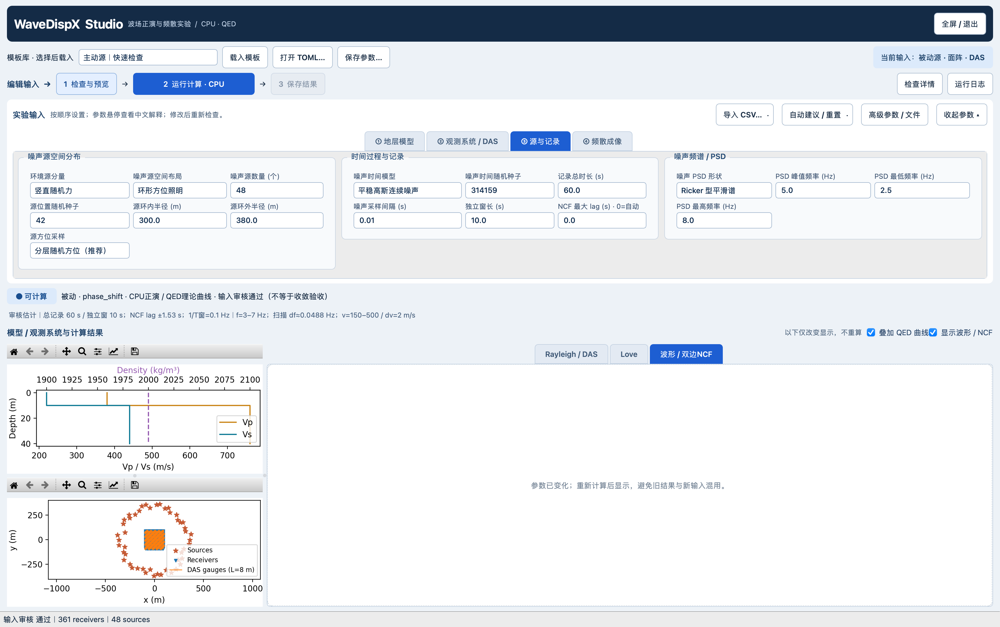
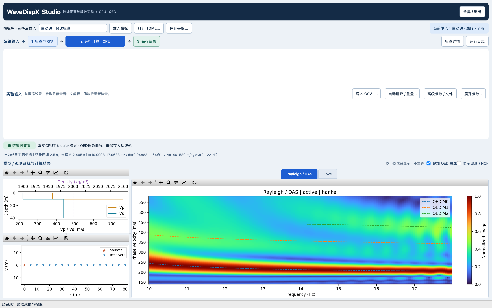

# WaveDispX Studio：交互实验工作台

2026-10-28阶段收尾：用户试用确认无操作阻断，当前作为可使用的源码阶段版本交付；不等于通用科学收敛认证或跨平台Studio安装包。功能、验证与已知限制见[收尾记录](RELEASE_20261028_zh.md)。新用户先看[仓库首页的源码安装和QED准备说明](../../README.md#从源码启动studio)。

当前入口：右上「示例与说明」可直接载入主动倾斜力、被动三分量R/L、炮点CSV、Poisson噪声或可选HVSR例子，也可在应用内阅读本说明。载入会替换当前输入但不自动计算，请先保存自己的参数。

「⑤ 计算 / 理论」现在可直接修改CPU workers、频率分块和噪声源分块。workers=0为内核自动选线程，不是全程序CPU上限；更多线程不保证更快。新加单侧源、双源簇、不规则面阵和逐窗强度切换例子，完整可复制输入包见[自定义文件说明](../../examples/custom_geometry/README_CN.md)。菜单也可打开该文件夹；「导入CSV」支持活动表导入/移除。

最新[普通窗口截图、源输入修复与被动R/L实际结果](windowed_20261028/README_zh.md)：含192源600秒两种极化的模型、PSD、Geometry、真实NCF及有/无理论覆盖能量图；没有把有限记录例称作收敛结果。

多台站HVSR显示已补齐：Geometry点选、最多12站曲线叠加、全部台站热图，均只读取现有结果；见 [操作与实际窗口截图](hvsr_multistation_20261028/README_zh.md)。仅H/V，不新增Z/H或NCF谱比。

新增功能（2026-10-28）：计算目标/Rayleigh-Love选择、主动矢量力、被动源H/V功率与方向、逐台站原始XYZ HVSR已接入Studio。操作、公式、示例TOML与完整窗口截图见 [新功能说明](products_v1_20261028/README_zh.md)。无响应/不支持时保留结果页和原因；Love-DAS仍未开放。以下早期截图和验收范围保留，不替代新功能记录。

2026-10-28，第一版可运行界面及第二轮操作/数值诊断。保留旧工作台，未覆盖课堂版、正演内核或自动参数算法。**界面可试用，自动参数尚未完成科学收敛验收，不是稳定发行版认证。** 详见 [本轮验收与未通过项](acceptance_20261028/README_zh.md)。

同日交互改版：主流程改为「编辑输入 → 1 检查与预览 → 2 运行计算 → 3 保存结果」。主操作蓝色、待检查琥珀色、错误红色；结果可查看用绿色并附文字，不代表科学收敛。参数按用途分组，显示开关移到结果区，可收起参数放大结果。最新截图在 `ux_v2_20261028/`，早期截图和数值诊断原样保留。

## 启动

在项目根目录执行：

```sh
sh scripts/launch_studio.sh
```

使用已有 `seisloc` 环境；不安装依赖、不使用 GPU。默认载入主动 quick 参数，仅做输入审核和预览，不自动运行正演。默认是可移动、可缩放的普通窗口，按当前屏幕可用区域留边，最大初始内容尺寸1600×960逻辑像素，适配16-inch MacBook；不默认全屏或最大化。右上按钮可自选全屏，Esc返回普通窗口。旧运行窗口不会被强制重启。

HVSR默认关闭，相关参数和结果页隐藏；需要时从「附加分析」启用。打开明确选择HVSR的配置文件时尊重文件选择。

## 哪些分量能算，不能算时怎么办

| 输入情况 | 能量结果与提示 | 如何调整 |
|---|---|---|
| 主动垂直点力 | Rayleigh可计算；Love没有横向激发 | 若需要Love，显式选vector并给水平横向力；不自动改源 |
| 主动vector | 按每一源台对投影R/T/Z；不保证两种波型均有响应 | 调方位/倾角并看Geometry；水平径向也可激发Rayleigh，水平不等于Love |
| 被动只保存ZZ | Rayleigh路径；Love提示缺少TT记录 | 选three_component，配置水平源功率和方向 |
| 被动三分量、水平功率0 | 仍可有径向观测；Love不被垂直源激发 | 需要水平源时明确增大horizontal_power_fraction |
| DAS | 当前垂直源路径；Love-DAS未实现/验收 | 不将Love理论曲线当作DAS能量，不开放水平/倾斜源DAS |
| 仅理论 | 不需要源激发或观测分量 | 只算所选波型；无有效根不等于证明物理上不存在该波型 |

结果页分别说明未选择、不激发、缺分量、零响应和失败；出错保留原技术信息。新计算目标不支持compare_methods和自动拾取；需要时回到兼容流程，而不是自动更换方法。

## 震源和噪声源怎样添加

- 主动：③源与记录直接填x/y；或「导入CSV → 主动炮点CSV」，从多行炮点中选本次一炮。尚不提供多炮批量计算和鼠标画炮点。
- 被动位置：选择环带、线状或导入x_m,y_m CSV。切换布局只替换位置字段，保留已有源数（CSV按行数更新）、极化、水平功率、方向、随机种子与activity_file。半径/线段新初值需自行检查，不是自动优化。
- 源活动表：高级参数中设置activity_file，表头window_index,source_index,amplitude_multiplier；索引从0开始，未列项幅值为0。更换坐标/源数/窗数后需核对编号和维度，程序不重映射或删除活动表。
- 时间：stationary_gaussian是逐独立窗带限随机过程，没有离散激发时刻表。poisson_ricker按事件率生成随机事件；新independent_hv/directed_hv极化目前只支持独立stationary_gaussian，不支持带方向事件目录。
- 方向与比例：independent_hv为水平无优选方向；directed_hv为所有源统一水平力方位。比例是源力PSD水平份额，不是接收H/V或Rayleigh/Love能量比例。逐源不同方向尚未提供。

可直接查看 [CSV格式和完整输入文件](../../examples/observation_system/README_CN.md)，以及 [源分量公式、限制和真实结果截图](products_v1_20261028/README_zh.md)。被动三分量短记录模板为 [passive_vector_energy_studio.toml](../../examples/passive_vector_energy_studio.toml)，明确不计算HVSR；24源/60秒仅功能示例，不能作为收敛或漂亮结果保证。

指定现有输入文件：

```sh
sh scripts/launch_studio.sh --template examples/active_das_grid_quick.toml
```

## 一屏怎么用

1. **载入模板或打开 TOML**：选择主动/被动、节点/DAS。载入模板会替换整套输入；先保存需要保留的 TOML。
2. **模型**：表格集中输入层厚、Vp、Vs、密度、Qp/Qs。末层厚度 `inf` 是半空间；按钮在半空间上方增删有限层。
3. **观测系统 / DAS**：线阵、二维面阵或 CSV；同页设置 DAS 开关、标距、方位及应变/应变率。未开启DAS时相应参数灰显。输入区右上「导入 CSV」提供接收器和DAS通道入口。线阵切面阵采用可编辑的布局初值，不等于自动设计了合适阵列；检查实际预览和源台是否重合。
4. **源与记录**：主动分为炮点与方向、子波与正演带宽、时间采样与记录；被动分为空间分布、时间过程与记录、PSD。炮点/噪声源/PSD CSV 从「导入 CSV」菜单导入，入口随当前模式变化。改为线状或环状噪声源会载入该布局初值，请确认数量和范围。
5. **成像**：f/v 范围、df/dv、成像方法等。`自动建议 / 重置` 菜单可填候选值或恢复模板中的自动参数默认值，之后都能手改；不会自动变成“已收敛”。完整参数、CPU 线程和输出目录在 `完整参数 / 文件输入`。
6. **1 检查与预览**：左侧显示 Vp/Vs/密度及真实源台 Geometry；`检查详情` 查看 required 错误和建议。所有常用参数的 hover 提示含中文含义、约束及影响。修改后立即隐藏旧模型/Geometry/结果，避免混用。
7. **2 运行计算 · CPU**：蓝色主按钮，后台线程完成依赖阶段。未检查的输入会先检查。结果先留内存，不自动保存大型波形。计算中输入锁定，显示无确定百分比的忙碌条，可看日志，尚不支持强制取消。
8. **看结果**：右侧 Rayleigh/DAS 与 Love 切换；`叠加 QED 曲线` 仅改显示，不重算能量；`显示波形 / NCF` 打开可选 Tab。主动横轴为炮检距、时间 0 在上；被动 NCF 横轴真实 −T 至 +T，纵轴按台间距排序，不把正支镜像成负支。
9. **保存**：TOML 只保存参数；另存时将已有文件路径解析为绝对路径，避免换目录后找不到接收器/源/PSD文件（跨机器仍需配置路径）。图形工具栏可保存单图。`保存计算结果` 只保存当前已计算的结果，不会在结果不存在或参数已改时偷偷启动正演。大型实验应通过服务器工作流运行/保存，本界面尚未提供远程任务提交器；不要把长时大规模案例当作本地 quick 运行。

参数修改会清除旧结果显示；格式错误提示具体字段并恢复输入框中的已接受值。物理上无效的数值会保留供修正，审核不通过时不能开始正演。`更新预览` 和求理论根仍在主线程，复杂模型可能短暂等待。

右上「当前输入」是实际主动/被动、布局与测量类型；左侧「模板库」只是待载入选择，未点击载入不会替换输入。「收起参数」只放大结果区域，不改参数或重算。较窄窗口/复杂文件输入仍可能需要参数区滚动，高级字段在「高级参数 / 文件」。

输入下方新增时长/网格摘要：计算前显示审核估计，计算后显示实际数组的 f、v 范围、点数、df/dv；区分主动记录周期与最后样点、被动总时长/独立窗/NCF lag。运行期间可打开日志。无效 TOML 导入不覆盖现有可用案例。

### 正演频率上限不是成像上限

`active_source.maximum_frequency_hz` 是正演截断，`processing.frequency_max_hz` 是频散图范围。不能仅把前者设得比后者略高。此次 7 Hz Ricker、16 m 标距例中，正演上限16 Hz产生明显晚时振铃；改为24/32 Hz后尾部显著减弱，成像范围仍固定3–14 Hz。这不是32 Hz通用默认值，也未认证所有模型。相关 hover 提示已更正；旧模板和自动算法没有被静默改写。

## 实际截图

下列为原生 Qt 完整窗口、实际主动 quick CPU 运行，不是设计稿。源/模型/成像输入见 [checked_input.toml](checked_input.toml)。这是短孔径流程检查，旁瓣和弱高阶仍保留，不冒充正式收敛示范。











可选波形、关闭理论覆盖、参数已修改、计算中截图分别见同目录 `waveforms.png`、`energy_without_overlay.png`、`modified_input.png`、`running.png`。波形仍遵守原坐标约定，能量色标/数值不变。

## QED、DAS 与版本边界

- Studio 理论曲线固定调用当前项目 QED forward 适配器，不提供 CPS 对照，也不在失败时切换后端。加载的 TOML 若原为 disba，此界面会按用户要求选择 QED，保存 TOML 会反映这个选择。
- QED 曲线只作诊断，不生成或替换频散能量。能量方法仍由 `dispersion_method` 决定：phase_shift、bessel 或 hankel；这和理论求根后端是两回事。
- 复用现有 CPU 频域离散波数内核及其波形/互相关处理链；本轮没有改变源平滑、频率窗、成像归一化或自动参数估算算法。内部自动设计不等于所有诊断都改用 QED。
- DAS 复用现有有限标距端点差分正演，不是给最终图乘经验滤波。二维面阵表示有方向的各道标距，不自动构造一条连续光缆。建议先载入 DAS 模板，其支持的分量/成像方法由 required 检查约束。
- 第二轮已完成8类模板的CPU计算/保存、4/8/16 m标距、600/1200 s被动记录及周期/频率截断诊断。发现的尾部振铃保留在原图和数据中；原标距对照不能直接作为已收敛的DAS幅值结论。界面仍无多标距并排管理器、远程任务、强制取消和完整结果重载。
- 保留当前本地课堂版/QED 已有更新，未根据目录日期或远程 main 自动升级。工作区含其他未提交工作，不能把 HEAD 当成完整运行版本；实际适配器、CPU 核和 QED 二进制 SHA256 见验证记录。

## 本轮验证

交互改版：`test_studio_ux.py test_studio.py test_studio_acceptance.py test_desktop.py` 最终 **39 passed in 37.31s**。新增状态/按钮锁定、DAS依赖字段、CSV菜单派发、收起参数不改输入、切换算例状态及旧画布立即隐藏回归。实际Qt后台CPU计算截图验证显示前后能量哈希一致；配置、源码/样式及二进制散列见 `ux_v2_20261028/UI_VALIDATION.json`。已检查浅色中文工具提示实际渲染（`cutoff_tooltip.png`）；记录时长/lag/df标签明确标注0=自动。本轮仅界面/交互，不扩展此前科学验收范围。

第二轮本机操作/接口回归88项通过；学校CPU完成8条路线与5个受控附加案例。Mac/Linux主动quick频散图相对L2差约6.07e-13、ZZ波形差约2.56e-8（Linux检查数组从float32 HDF5重载）。这是同算法平台一致性，不是独立物理验证。详见 [验收说明、可见QC及复现命令](acceptance_20261028/README_zh.md)。

以下保留首轮21项及窗口截图验收信息，不能替代第二轮数值诊断：

```sh
PYTHONPATH=python_src conda run --no-capture-output -n seisloc pytest -q \
  python_tests/test_studio.py python_tests/test_desktop.py \
  python_tests/test_qedisp.py python_tests/test_plotting_axes.py --tb=short
PYTHONPATH=python_src conda run --no-capture-output -n seisloc python scripts/check_studio_ui.py
```

本机 21 passed（15.06 s）。覆盖实际主动计算、QED 叠加开关、被动字段、DAS 121 道面阵预览及标距修改、错误输入、旧结果失效、波形轴约定。原生脚本通过点击计算按钮走后台工作线程，完整截图已人工查看。能量数组显示前后 SHA256 完全相同，详见 [UI_VALIDATION.json](UI_VALIDATION.json)。没有修改物理/成像内核，故不继承或新增任何跨模型正演精度结论。

按 diagnose 技能排查并复用了课堂版的进程级 Qt 插件绑定，解决 PySide6 wheel 与 Conda Qt 混载崩溃，未修改环境安装。截图运行仍出现一次 Matplotlib constrained-layout 警告；交付的可见图已检查无缺轴/裁切，该警告未被当作数值失败或静默屏蔽。computer-use 无法按 Conda 命令行 Python 路径绑定此应用；当前验收依据为实际 Qt 测试和窗口截图，而非声称已完成该工具的鼠标遍历。
