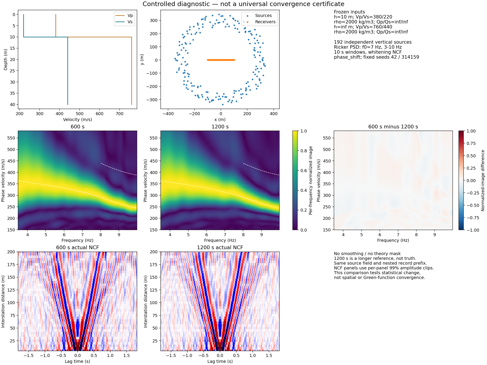
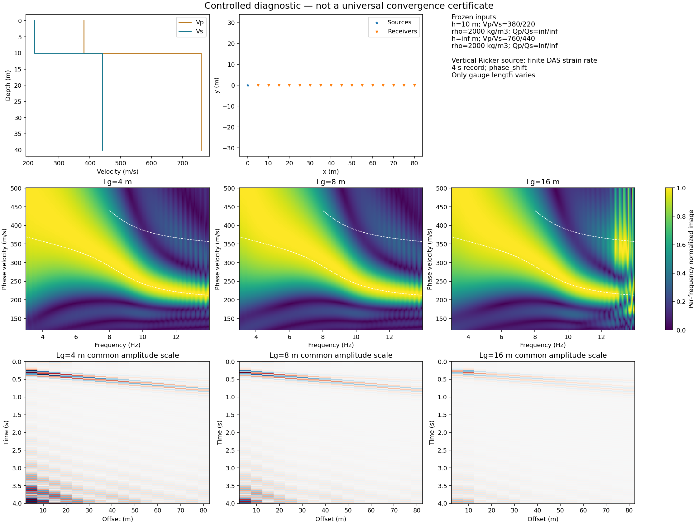
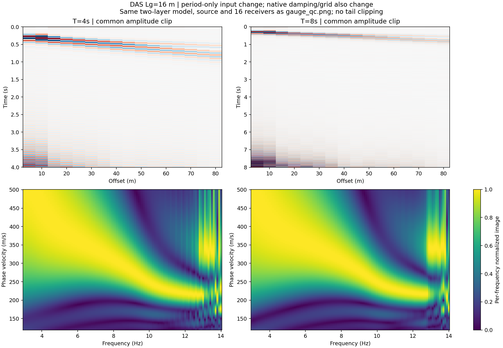
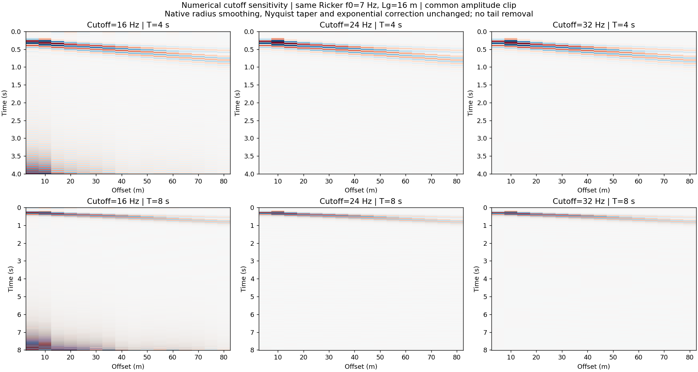

# Studio 第二轮验收与数值诊断

日期：2026-10-28。结论：**操作链路可试用，自动参数/科学收敛验收未完成。** 全部CPU，无GPU；未安装依赖，未更改正演、成像、源平滑、频率窗和自动参数算法。未推送GitHub或发布稳定版。

## 这次修复了什么

- 物理参数即使TOML写成整数也能改成小数；数量和随机种子仍为整数。
- 被动Love页读取已有TT结果，不再误显示为空。
- 计算时可打开日志，重复打开复用同一窗口，不出现空白页。
- TOML另存到其他目录时保留实际CSV/PSD/activity路径；不修改编辑中的配置。
- 无当前结果时保存按钮只提示先计算，不启动正演。
- 无效导入保留原案例；Poisson事件率及有效布局别名正确显示。
- 显示真实计算坐标/点数，区分记录总时长、独立窗、lag、扫描df和1/T。
- 根据实际截断试验修订正演频率上限及记录时长的中文hover提示。

本机回归：88 passed。先复现5项失败再修复。测试包含真实CPU小例、Qt参数/文件导入交互、8模板预览、DAS及坐标轴；不是声称8类都经原生鼠标逐个操作。窗口完整截图由Qt实际计算流程取得并已查看，见上级目录。computer-use不能绑定此Conda Python应用，未据此伪称完成原生鼠标验收。

```sh
PYTHONPATH=python_src conda run --no-capture-output -n seisloc pytest -q \
  python_tests/test_studio_acceptance.py python_tests/test_studio.py \
  python_tests/test_desktop.py python_tests/test_app_service.py \
  python_tests/test_preflight.py python_tests/test_plotting_axes.py \
  python_tests/test_das.py --tb=short
```

## 8条实际计算/保存路线

原模板不替换模型/源/阵列，统一CPU workers=4及Studio的QED理论覆盖。阶段耗时包含审核、正演、处理、存储和绘图，单次运行且首例含冷启动；不是纯内核性能基准。

|模板|耗时s|结果|
|---|---:|---|
|active_quick|9.93|计算、有限非零能量及HDF5保存通过|
|manual_active_array|24.67|同上|
|passive_quick|1.55|同上|
|passive_grid_quick|8.10|同上|
|active_das_line_quick|2.49|同上|
|active_das_grid_quick|3.15|同上|
|passive_das_line_quick|1.66|同上|
|passive_das_grid_quick|301.58|同上，但361道/64980对台站明显偏慢|

通过含义仅是集成smoke-pass，**不表示波形与频散已经准确或收敛**。DAS被动面阵尚需性能定位；不能称为交互式quick体验。

## 时长、标距和截断

被动：固定192源位置、源/时间种子42/314159、10 s独立窗，从600增至1200 s。归一化能量图相对L2变化4.885%，NCF变化10.148%，分母为1200 s结果范数。预设5%图像诊断目标仅图像满足；1200 s不是真值，且未检查独立种子/源数量/方位收敛。



DAS：同模型、源、接收器中心和方向，Lg=4/8/16 m，记录固定4 s。波形用共同幅值色标；能量逐频归一化会隐藏绝对幅值衰减。**原16 Hz正演截断带来明显尾部振铃，因此这组不能用于定量认证标距衰减。**



固定Lg16 m，T4→8 s，原16 Hz截断下频散图变化11.051%。相同4 s波形只将df/dv从0.1 Hz/2 m/s加密为0.05 Hz/1 m/s，共同网格图像变化0.0113%；不能据此证明加密点之间所有弱峰均已解析。



进一步保持Ricker主频7 Hz、dt=.005 s、成像3–14 Hz不变，只比较正演频谱截断16/24/32 Hz及T4/8 s。模型h=10/inf m、Vp=380/760、Vs=220/440 m/s、rho=2000/2000 kg/m³、Q=inf；垂直炮点(0,0)，16个DAS中心(x=5:5:80,y=0)，轴向x，Lg16 m，应变率。原生源半径平滑、Nyquist余弦窗及指数校正均保留，非等价频谱产品。

|正演截断Hz|4 s近道末20%能量占比|8 s近道末20%能量占比|T4→8图像相对L2|
|---|---:|---:|---:|
|16|49.78%|79.75%|11.05%|
|24|0.00909%|0.02858%|3.210%|
|32|0.00196%|0.000137%|3.245%|

末20%只是诊断区间，不是通用通过阈值。截断敏感性支持“正演带宽不足是明显振铃的重要原因”；代码中频谱零截断和时域指数恢复提供机制线索，尚未逐项分离机制贡献。提高截止后仍有约3.2%周期差，不能宣布原生时域合成完全收敛。不能把32 Hz复制为其他子波/模型的通用默认。



后续顺序：先完成子波频谱覆盖、周期/复频移及弱能量频带检查，再修改自动候选/模板；然后重新做标距对照和被动收敛。不会用平滑、只截前半段或理论根附近掩码制造好看的验收图。自动范围内部仍使用disba/dunkin，QED用于最后理论覆盖；本次没有全链替换。

## 平台、来源及复现

Mac/Linux同算法主动quick一致性：图像相对L2=6.0696e-13，ZZ波形=2.5635e-8。预设阈值分别1e-6/1e-5；波形Linux侧从float32 HDF5重载。见 [platform_check.json](platform_check.json)，这不是独立求解器物理验证。

完整计算留在学校服务器：

`lx_lzf:/storage/HOME/yaolab/liuxin/wavedispx_classroom_build_20261027/studio_acceptance_20261028/`

- `results_v2/`：13个实际计算的冻结输入、HDF5、QC及manifest；图表恢复由保存数组重绘，未重跑正演。
- `window_sampling/`：周期/成像采样检查。
- `cutoff_sampling/`：6组冻结TOML与实际数值NPZ。
- 初次`results/`保留脚本错误记录：误将review属性当作方法，计算尚未开始。随后改用review_inputs并新建results_v2。首轮DAS绘图错误为读取wrapper而非data，已从成功保存的HDF5恢复绘图，见report.plot_recovery。

服务器解释器为已有`miniconda3/envs/disba/bin/python`（3.13.9）；用已有bf312环境pybind11头文件编译本项目C++核，无新增安装。QED复用同项目`build/solvers/forward`；配置及二进制哈希见[report.json](report.json)。CPU环境设置`OPENBLAS_NUM_THREADS=1 OMP_NUM_THREADS=4`，`PYTHONPATH=python_src`及显式`QEDISPINV_FORWARD`路径。脚本：`scripts/run_studio_acceptance.py --output results_v2`、`scripts/check_studio_window_sampling.py --output window_sampling`、`scripts/check_studio_cutoff.py --output cutoff_sampling`。不要向已有结果目录重复运行以覆盖历史。

本地只保留小图、报告及小型平台检查数组。源码和交付散列见`PROVENANCE.json`。当前工作区含其他任务改动，HEAD不是完整运行版本；没有打包/提交整棵dirty tree，也没有改动历史科学结论。
