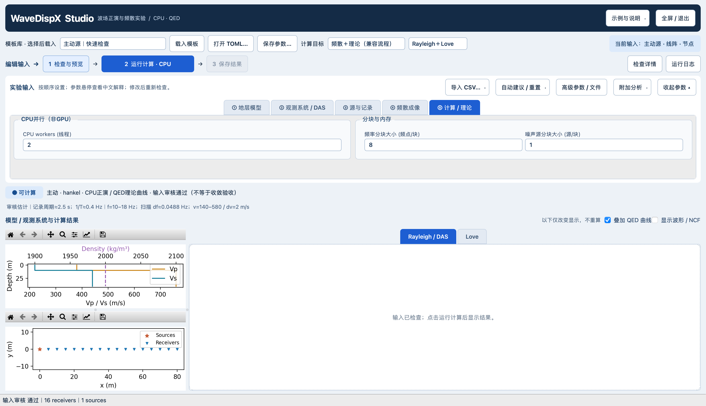

# CPU选项与自定义噪声源输入：使用及验证

2026-10-28。范围：Studio运行选项、CSV导入、三个可修改示例及中文说明；不修改正演、互相关、成像内核或自动参数算法，不构成新的物理准确性或收敛认证。

## 从哪里操作

「⑤ 计算 / 理论」设置CPU workers、频率分块、噪声源分块，悬停有中文解释。workers=0自动，1单工作线程；它不是全程序CPU线程上限，也不是并行炮数。分块不是频率间隔或源数量。参数可保存到TOML，非法整数/范围会定位报错。

「示例与说明」可载入东侧单侧源、东北/西南双簇、双簇活动随时间切换三个例子，也可打开输入目录和说明。「导入CSV」支持逐窗活动表及移除；校验成功才替换原输入。当前已打开的旧进程需先保存参数，再重新启动以加载新代码。

完整字段、单位、坐标系、相对路径、索引及权重规则见[自定义输入说明](../../../examples/custom_geometry/README_CN.md)。活动表按源坐标行的零基索引关联，不按source_id标签关联；振幅0.2对应功率0.04。切换例同时改变照明和总源功率，不是恒定总功率实验。

## 可查看的输入与结果

| 示例 | 完整窗口 | 模型/Geometry/PSD | 实际双边NCF | R/L能量及理论 |
|---|---|---|---|---|
| 东侧12源、41站线阵 | [界面](ui_final/east_line.png) | [输入](results/passive_east_line_inputs.png) | [波形](results/passive_east_line_ncf.png) | [能量](results/passive_east_line_energy_theory.png) |
| 东北8源/西南4源、25站不规则面阵 | [界面](ui_final/clusters_array.png) | [输入](results/passive_clusters_array_inputs.png) | [波形](results/passive_clusters_array_ncf.png) | [能量](results/passive_clusters_array_energy_theory.png) |
| 相同双簇/面阵、前后3窗活动切换 | [界面](ui_final/switching_array.png) | [输入](results/passive_switching_array_inputs.png) | [波形](results/passive_switching_array_ncf.png) | [能量](results/passive_switching_array_energy_theory.png) |

三例60s、6个独立10s窗、12源，采用有限混合噪声记录的NCF成像，非逐源理想互相关。它们是输入/非均匀照明演示，不是收敛展示。面阵孔径仅约40m，能量明显较宽；延长记录不能补足孔径或缺失源方位。未为使图变好看修改平滑、源窗、成像权重或用理论掩膜筛选能量。HVSR关闭。原始未叠加理论的图亦保留为各例`_energy.png`。

## 验证与可追溯性

- 本机seisloc：`test_custom_geometry.py test_studio_ux.py test_studio.py test_app_service.py test_desktop.py test_source_products.py test_hvsr_view.py`，73 passed in 33.46s；1条隐藏画布constrained_layout警告保留，最终可见普通窗口已查看。
- 小型主动矢量源回归：workers=1与2的XYZ波形及R/L能量在rtol=1e-12、atol=1e-14内一致，坐标轴相同；不代表任意机器/线程数均逐位一致或已获得加速。
- 三模板预览、坐标/活动表读取、非法运行选项拒绝、活动表导入/清除均有测试。真实Qt脚本修改workers=2并验证配置，三例预览截图及文件哈希见[UI_VALIDATION.json](ui_final/UI_VALIDATION.json)。截图为实际Qt脚本，不声称人工逐按钮computer-use验收。
- 学校服务器CPU三例实际计算/保存完成，得到有限非零R/L能量；[report.json](results/report.json)记录输入、CSV、源码、二进制和数组哈希。仅小图和报告回传，原始数组保留在服务器。

服务器结果：`lx_lzf:/storage/HOME/yaolab/liuxin/wavedispx_classroom_build_20261027/studio_products_20261028/custom_inputs_20261028_v1/`。报告SHA256在服务器与本机独立核对一致：`288f3e2526766a8dc38513bfe636357884c8d59c02c0241019ffc9d2332616cb`。

本轮关键代码SHA256：

| 文件 | SHA256 |
|---|---|
| python_src/wavedispx/desktop/studio.py | c7ec4a719661701f885cd77baf881052dd00d0e40b23bc9c67d616226f6a5fe2 |
| python_src/wavedispx/desktop/help_text.py | 04afa540e3c0bdfe372f24a6b3df325b53702a953a26f41c8af9928a50c86603 |
| scripts/check_passive_vector_energy.py | c5675c6807adefc0500682f89aea276f7dc33b32be12fa85b87c54951bd5a1ba |

未使用GPU，未安装依赖，未更改用户旧运行窗口，未推送或发布。上述验证限于所列输入和接口，不继承其他模型、源分布或记录时长的收敛结论。
