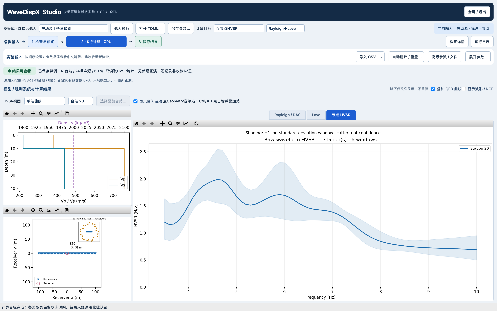
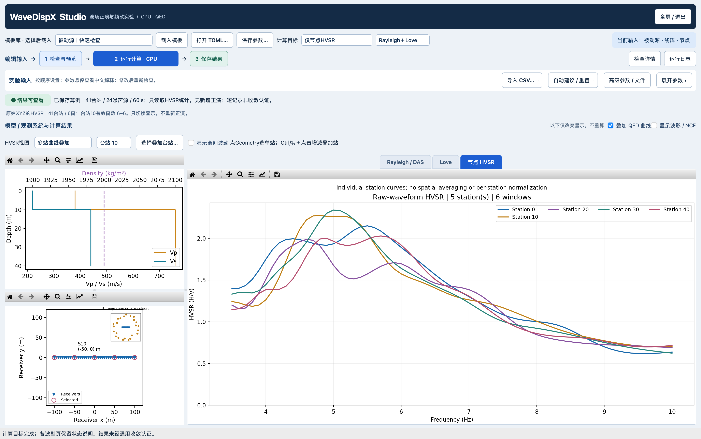
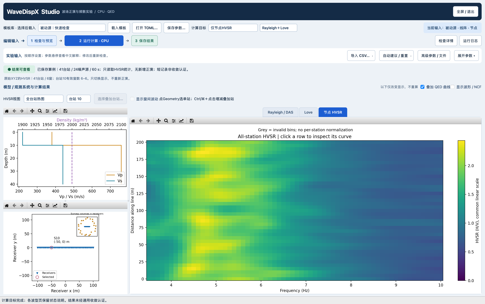

# 多台站 HVSR：查看与操作

本次只增加显示/交互，不修改原始XYZ的HVSR公式、不新增Z/H或NCF谱比、不重新正演。采用上次服务器已保存的41台站、24源、60 s（6个10 s窗）定向噪声算例；短记录只展示功能，不代表统计收敛。

## 界面操作

HVSR是默认关闭的附加分析：普通频散流程不计算HVSR，主计算目标不列出HVSR，其参数和结果页也不显示。需要时打开「附加分析」，选择「仅计算节点HVSR」或「频散＋理论，并计算节点HVSR」。关闭附加分析会恢复此前的主计算目标，不自动改变源分量。读入明确选择HVSR的配置文件时尊重该选择；完整高级TOML中可以保留未启用的HVSR参数，它们不会触发计算。

启用并完成计算后自动打开「节点HVSR」。视图下拉框：

- **单站曲线**：横轴频率Hz，纵轴H/V。下拉框选择台站，或点击左侧Geometry的接收器；编号按输入顺序从0开始。
- **多站曲线叠加**：点击「选择叠加台站…」勾选1–12站；初始选择5个均匀间隔的台站。没有空间平均，没有逐站归一化。默认只显示曲线，可勾选「显示窗间波动」。
- **全台站热图**：共同线性色标为真实H/V；无效值灰色，不补零。线阵按沿线距离排序，以一端为0；面阵按输入台站编号排列，不伪造一条测线。点击热图某行转到对应单站曲线。
- **分量谱/方向诊断**：保留原XYZ振幅谱和方向H/V等诊断；它不是单站主曲线的替代。

Geometry主图放大接收器，标出当前台站坐标；小图保留完整噪声源—接收器分布。Ctrl/⌘＋点击可增减叠加台站。工具栏缩放/平移模式下暂停点选，退出工具模式后恢复。窗间波动是±1个对数标准差，不是置信区间。修改物理输入后旧结果立即隐藏，不用旧曲线冒充新结果。

## 本次实际展示







本机16-inch MacBook逻辑画布1728×1084、Retina 2×；可收起参数放大图。曲线和热图相同频率轴、未逐站归一化。所有图由真实已保存数值生成，不是设计稿。

以上截图记录多站展示验收时的界面；随后入口已移至「附加分析」，结果图与谱比算法未改。

## 重开这份已有结果

在项目根目录运行：

```sh
PYTHONPATH=python_src conda run --no-capture-output -n seisloc \
  python scripts/show_hvsr_multistation.py --keep-open \
  --output docs/studio/hvsr_multistation_20261028/screenshots_final
```

此脚本读取现有结果，不启动噪声合成。展示结束保留交互窗口。只将原服务器输入中的运行输出目录显式映射到本地 `output_python/hvsr_interactive_demo`，物理/源/成像参数不变；修改输入后点击计算仍是普通Studio流程。快照不含原始波形，波形页会说明缺少记录，不自动重算。

## 来源与显示验收

原结果：`lx_lzf:/storage/HOME/yaolab/liuxin/wavedispx_classroom_build_20261027/studio_products_20261028/examples/results_final/passive_directed_h/experiment_1793169186538740127/arrays.npz`。

只提取`hvsr_*`统计（不含首窗波形）和`geometry_*`到本目录`hvsr_display_only.npz`，351783 bytes；全波形仍留服务器。原输入/manifest见 `../products_v1_20261028/server_final/manifests/passive_directed_h/experiment_1793169186538740127/`。Mac重新生成的一个源坐标与Linux相差1.42e-14 m；核对后绘图使用原保存坐标，不用再生成坐标覆盖原数据。

`screenshots_final/VALIDATION.json`记录快照哈希、显示前后全部HVSR数组哈希、源码散列、真实Qt鼠标点选站10及窗口尺寸。测试覆盖线阵排序、面阵ID、NaN保留、空选择、Geometry点选、多选、热图点选和输入变化失效。没有新增物理准确性或多种阵列噪声收敛结论。初次`screenshots/`保留调试过程，最终展示使用`screenshots_final/`。

最终回归：`test_hvsr_view.py test_studio_ux.py test_studio_acceptance.py test_source_products.py`，**43 passed in 24.64s**。`git diff --check`通过。绘图前后全部HVSR数组SHA256均为`ae12f1051d91b192fcae3dd584ab87c89f1b4ef23999175241e55ce441af8f85`。真实Qt截图日志仍有隐藏画布的constrained-layout警告；最终可见图已查看，主图频率轴与说明不再重叠。
