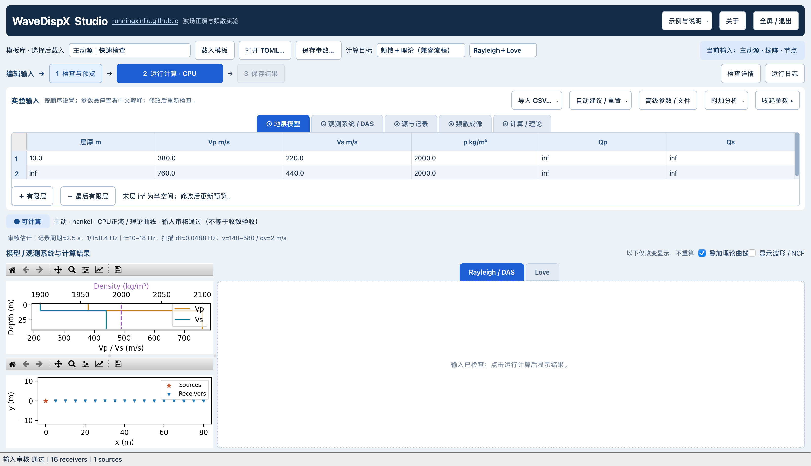

# Studio 品牌与跨平台包装记录

2026-10-28。用户授权左上软件名后显示个人网站、关于窗口感谢Pan Lei的QEDispInv，并推进跨平台封装。主界面品牌/常用曲线标签不再写CPS/QED；实际求解器、源输入、数值设置与来源记录不删改。

界面与路径回归：27 passed，1条已有小画布布局警告，22.38s。初次运行发现新增运行路径处理覆盖了原Studio输入刷新方法，8项UI测试失败；已合并回原方法并重跑通过。只改显示/平台入口，不改正演或成像算子。

打包说明见[Studio安装与验证](../../../packaging/studio/README_zh.md)。构建当前处于候选验证阶段，不等于已经有四平台可发布成品。只在实际打包程序通过数值、保存、中文路径、字体和GUI检查后生成压缩包。

8例源环境基准与GUI链路已在学校服务器完成，全部输出比对及保存成功，默认主动兼容入口也通过。参考数组按案例无损分文件，见[文件及哈希清单](../../../packaging/studio/reference/FILES.json)及[配置/哈希记录](../../../packaging/studio/reference/provenance.json)，是小型平台回归快照，不是新科学验收。原始保存目录：`lx_lzf:/storage/HOME/yaolab/liuxin/wavedispx_classroom_build_20261027/studio_products_20261028/studio_packaging_reference_20261028_v1/`；源码GUI证据`studio_source_ui_20261028_v1/`、修复导出后的`studio_source_ui_20261028_v2/`。完整波形/构建目录留服务器或对应平台构建机，不下载全部到本机。

尚需完成：四平台原生成品构建与测试、下载包核验、签名/公证策略、第三方许可记录核对。保留未签名试用状态，不把已有Classroom四平台证据迁移为Studio通过。

包装验收补充了真实配置重载：复现CSV结果input.toml仍引用旧相对目录的问题（新测试修复前失败），结果导出现在复制小型外部输入到inputs/并登记SHA256，重载独立于模板目录；原CSV与输入mapping不变。此为保存格式的兼容性补充，字段结构/计算数值不改。数值基准仍用原固定数组，导出修复不产生新的物理验证结论。
