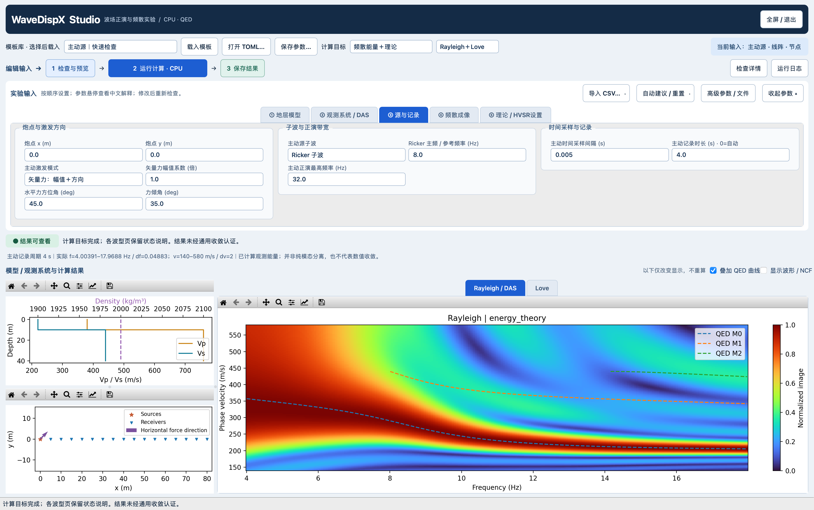
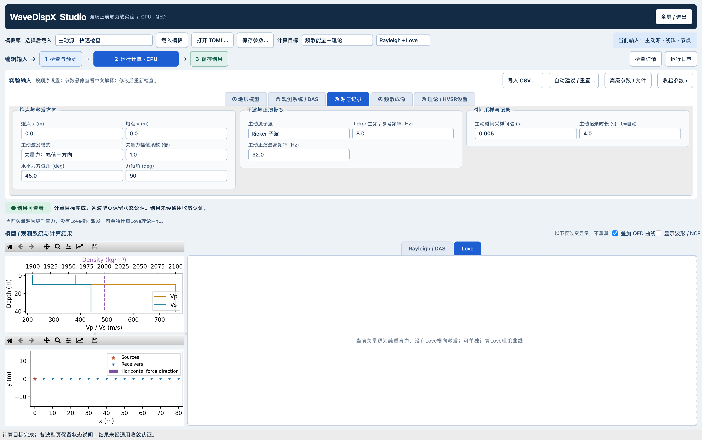
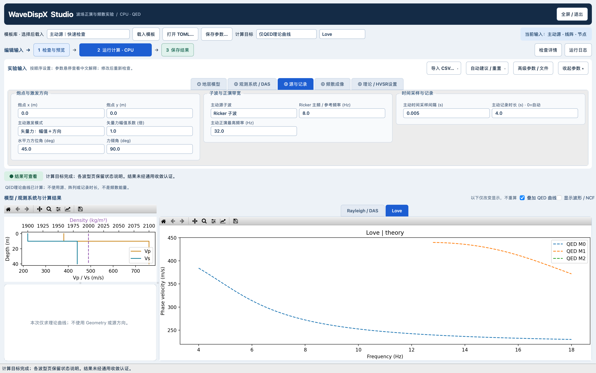
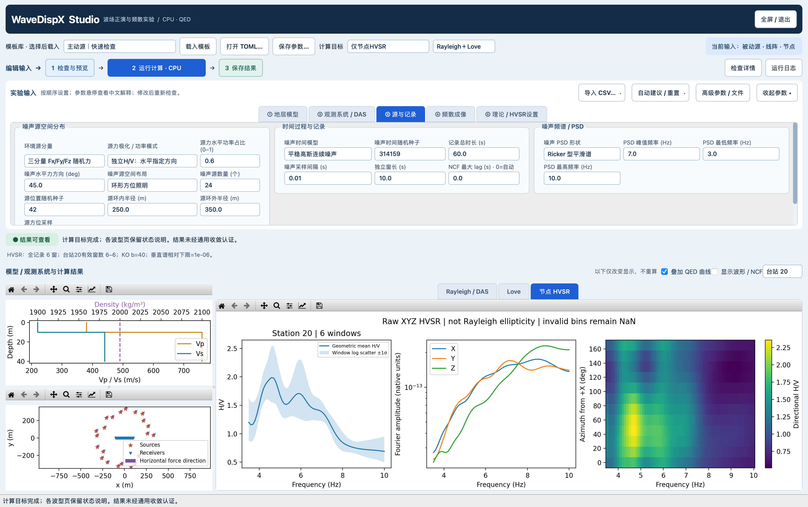
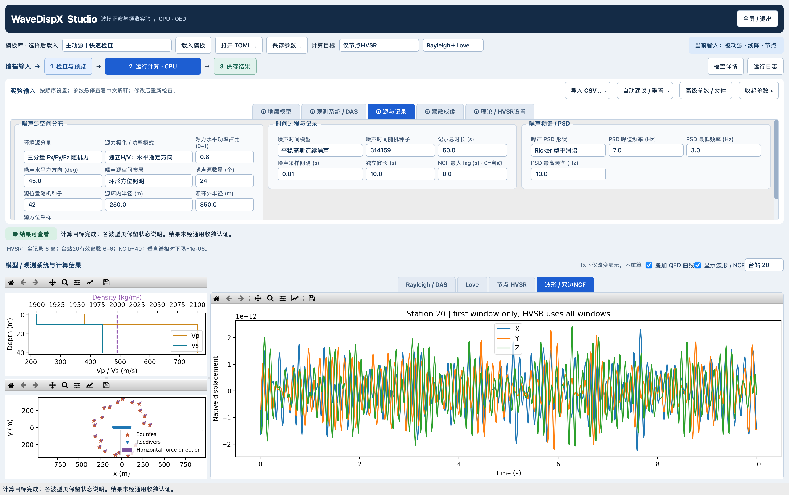

# Studio 计算目标、矢量源与节点 HVSR v1

2026-10-28。已实现并做小型端到端检查；**不是噪声充分收敛或全模型物理精度认证**。沿用当前 CPU 离散波数正演与 QED 理论适配器，未更改原生 Green、源半径平滑、频率窗或成像内核，不使用 GPU。

## 怎么操作

关闭旧窗口前先保存自己的输入。重新运行 `sh scripts/launch_studio.sh`，或通过「打开 TOML」载入：

- [倾斜主动矢量源](../../../examples/active_vector_studio.toml)：一个物理力的 XYZ 相干响应，水平角45°、倾角35°、幅值系数1；4 s记录、32 Hz正演截断是本例输入，不是通用默认。
- [定向被动源与节点HVSR](../../../examples/passive_hvsr_studio.toml)：24源、60 s、6个10 s独立窗，水平源力PSD占比0.6、统一方位45°。这是功能演示，不是正式长记录结果。

顶部选择「计算目标」与「输出波型」，然后按「检查与预览 → 运行计算 → 保存结果」。HVSR默认关闭，只在「附加分析」中启用；打开明确指定HVSR的文件时保留选择。右上「示例与说明」可以直接载入以上案例及被动三分量R/L能量例。参数集中在③源与记录、④频散成像、⑤理论设置；HVSR参数仅启用后出现。中文 hover 提示包含参数含义和适用限制；Geometry 中箭头表示水平力方向，不是射线路径。默认普通窗口，以下全屏图是历史验收截图，不代表当前启动方式。

| 计算目标 | 实际执行 | 不代表什么 |
|---|---|---|
| 仅QED理论曲线 | 模型、理论频率和模态数；不执行波场/互相关 | 不代表源实际激发了该模态 |
| 仅频散能量 | 波形或真实混合噪声NCF，再用所选成像方法 | 不以理论曲线生成能量；输入审核仍可能调用理论诊断 |
| 频散能量＋理论 | 所选波型的能量及独立理论覆盖 | 不是纯模态分离或收敛认证 |
| 仅节点HVSR | 全记录原始XYZ逐窗谱比 | 不用NCF、白化记录或DAS应变 |
| 频散＋理论＋HVSR | 两条处理链共享Green；确定性重放同一噪声实现 | 当前会重复合成噪声窗，不是零额外计算成本 |
| 兼容流程 | 保留旧完整分析/拾取/保存路径 | 旧`both`仍是载荷基响应集合，不是一个斜向物理力 |

Rayleigh 和 Love 标签始终保留。未选择、没有激发、缺少记录分量、全零响应或计算失败均说明原因；不会把零能量图或一条理论线冒充有效成像。理论求根无有效值时，也不会据此断言物理上不存在该波型。

新目标暂不提供多方法比较或自动拾取，`processing.compare_methods=true`明确拒绝；如需旧拾取流程使用兼容模式。`[experiment]`由 Studio/`run_experiment`解释，旧CLI和旧工作台不负责这些新产品，不应直接用旧入口执行下列示例并期待HVSR。

## 主动源：同一个力的相干分量

选择 `active_source.component="vector"`：

\[
\mathbf F=A(\cos i\cos\phi,\cos i\sin\phi,\sin i),\qquad
\mathbf u(\omega)=\mathbf G(\omega)\mathbf F\,s(\omega).
\]

`force_amplitude`为原单位载荷的倍数，不额外声称牛顿标定；`force_azimuth_deg`从全局+X向+Y，`force_inclination_deg`从水平面向原生Green的+Z。**尚不将原生Z符号自动解释为向上、向下、ENU或NED。** 倾角0°纯水平，±90°纯垂直。所有分量用同一子波，按源台方向转换到局部R/T/Z后相干叠加。

水平源不等于只激发Love：相对于某个源台对的径向力也可产生P–SV/Rayleigh；横向力产生SH/Love响应。面阵每个源台对方向不同。图上Rayleigh来自实际径向/垂直观测，Love来自实际横向观测，并非纯模态滤波。多分量能量合并仍沿用现有图像归一化/合并定义，不能把色标读成绝对辐射功率。

## 被动源：功率比例与方向

选择 `ambient_sources.component="three_component"` 保留XYZ观测，再选 `polarization`。设单份输入源PSD为 S、水平总功率占比为 pH：

- `independent_hv`：X/Y/Z独立，PSD为 `(pH/2, pH/2, 1-pH) × S`；水平无优选方向。
- `directed_hv`：同一水平随机过程沿方位φ投影，X/Y相干，V过程独立；水平总PSD=pH×S，垂直=(1-pH)×S。
- `legacy_xyz`：旧XYZ等谱幅值不变，总源PSD是3份S。新模式总PSD是1份S；比较绝对振幅必须显式处理这个差异，不能仅把pH设成2/3就说与旧模式完全等价。

实现按 **sqrt(功率权重)** 缩放频域随机系数，不把功率比例误当振幅比例。pH是输入源力PSD比例，不是接收器H/V，更不是Rayleigh/Love能量比例。pH=0仍可产生径向接收响应，故不关闭XYZ记录或节点HVSR。

新加权模式目前只支持独立源、`stationary_gaussian`，每个源使用同一个全局水平激发方向。已有源位置CSV、时间窗activity权重和PSD输入继续使用；位置方位不等于力方位。**逐源不同方向、随机事件方向、带方向的Poisson事件目录尚未实现**，不支持的组合显式拒绝。

## HVSR 的计算定义

使用全部配置记录时长，按现有独立窗流式处理，不只使用界面60 s预览缓存：

1. 原始混合XYZ波形（含配置的接收噪声），逐窗去均值、10% Tukey窗、同一FFT振幅约定。
2. 水平合成 `H=sqrt((|X|²+|Y|²)/2)`；先合成H，再对H和V振幅谱分别做可选Konno–Ohmachi平滑，最后相除。
3. KO参数b=40可改，0关闭；本实现对选定频带内离散频点归一化，频带边界受到截断影响，应扩大频带检查。实际FFT间隔是1/窗长，不是成像补零后的df。
4. 垂直谱低于每台每窗最大垂直谱×`hvsr_floor_ratio`、不足10周期/频点、零分子等标无效；每频点至少3个有效窗，否则NaN。相对下限是数值筛查，不是仪器噪声模型。
5. 逐台站、逐频点对有效窗H/V做几何平均；阴影是±1个对数标准差的窗间散度，**不是置信区间**。方向谱每15°把复水平谱投影后取幅值，不是直接相加X/Y振幅。

结果Tab显示H/V、XYZ振幅谱和方向H/V；右侧台站选择器逐站查看，不默认空间平均。可选波形页只展示首窗原始XYZ，但统计使用全记录。H/V可能同时受源分布、极化、体波/面波组成和模型影响；它不是Rayleigh理论椭圆率，也尚未实现完整HVSR峰值可靠性/稳定性准则或反演。

## DAS边界

当前DAS仍要求垂直源，有限标距端点差分及应变/应变率路径不变。水平/倾斜DAS与Love-DAS未实现/验收，不因可以画Love理论曲线而开放。节点XYZ的HVSR不能替换为单轴DAS应变谱比。后续扩展需要先验证完整张量投影、光纤方向和标距响应。

## 实际完整窗口截图

1728×1084逻辑画布、Retina 2×，真实Qt后台CPU计算。参数区允许滚动，完整窗口不等于所有高级字段同时展开。

图形检查发现的限制：主动短孔径低频能量较宽，不修图隐藏；60 s HVSR有明显窗间波动，不宣称收敛。初次截图自动脚本曾只修改内部倾角而未改可见文本，`ui/`保留为调试证据，不作为操作手册截图；`ui_final/`改为真实输入框编辑。另修复工作线程结束后Retina画布密度副轴未完整重绘，主动/理论最新复核见`ui_render_fix/`；原日志中的隐藏画布布局警告保留，不伪称没有警告。

## 保存、复现与证据

新产品保存到独立 `experiment_<timestamp>/`，含输入TOML、NPZ与manifest；不覆盖旧 `results.h5`。保存实际能量轴、理论曲线、源/接收器坐标、矢量力与XYZ（主动）、NCF（执行过相关时）、HVSR统计及首窗预览。不是全时长原始波形归档；大型波形仍应留服务器。manifest记录输入、数组、相关Python模块和所用二进制SHA256。

服务器工作目录：`lx_lzf:/storage/HOME/yaolab/liuxin/wavedispx_classroom_build_20261027/studio_products_20261028/`。最终四例报告在 `results_final/report.json`，报告中的`output`是各自原数组/输入/manifest实际绝对路径（位于`examples/results_final/`）。本地仅保留小型报告/QC，不拉取全部波形。

受控验证包括矢量线性叠加与旋转协变、源PSD平方根权重、已知H/V=2恢复、零垂直谱无效掩码、旧系数原样保留、理论不运行正演、UI状态与波形坐标。服务器纯横向线阵例Rayleigh响应为零；倾斜例R/L均有响应。两种被动模式HVSR首窗与NCF生产器的原始预览相对L2差均约2.54e-8（预览float32），证明走相同随机实现，**不是独立物理验证**。

可复现脚本：`scripts/check_source_products.py`（学校CPU、小型端到端），`scripts/check_studio_products_ui.py`（本机真实Qt按钮/线程/截图）。最终本机11个相关测试文件 **117 passed in 62.98s**；兼容主动quick能量数组哈希与改动前一致。命令、范围和最终文件哈希见 [VALIDATION.json](VALIDATION.json) 及项目`EVIDENCE_REGISTER.md`。未修改其他聊天的冻结结果、未发布新安装包或推送GitHub。
