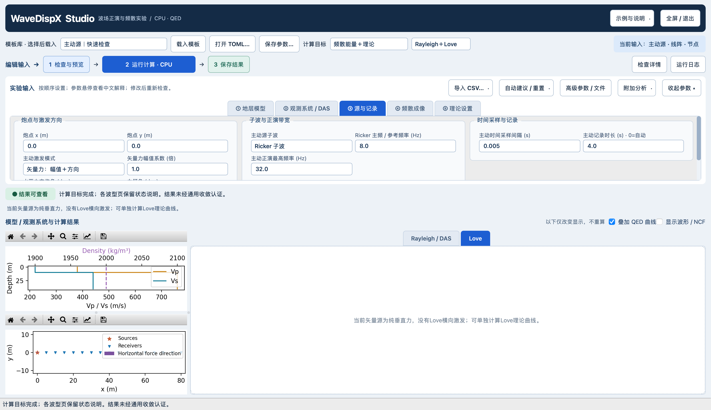
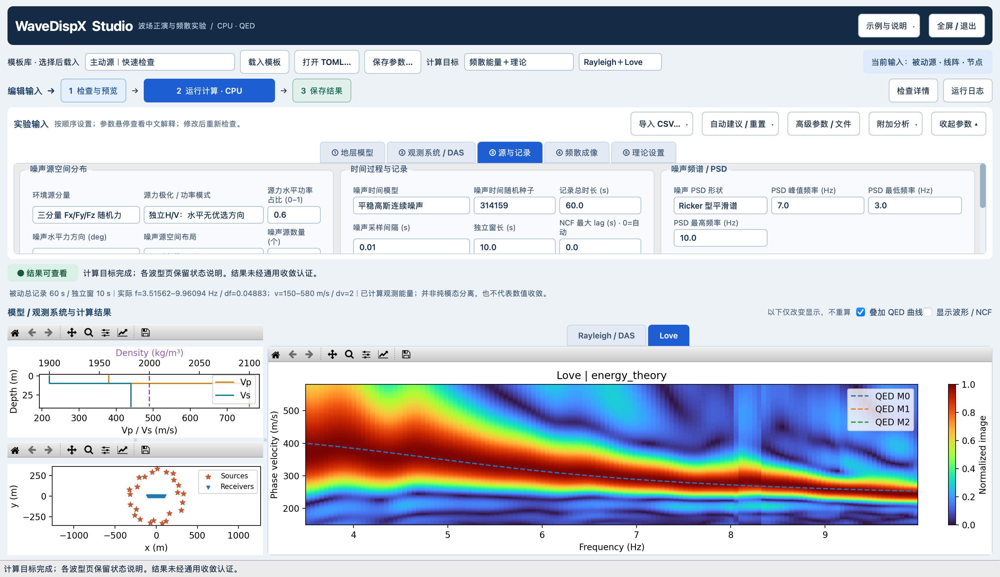
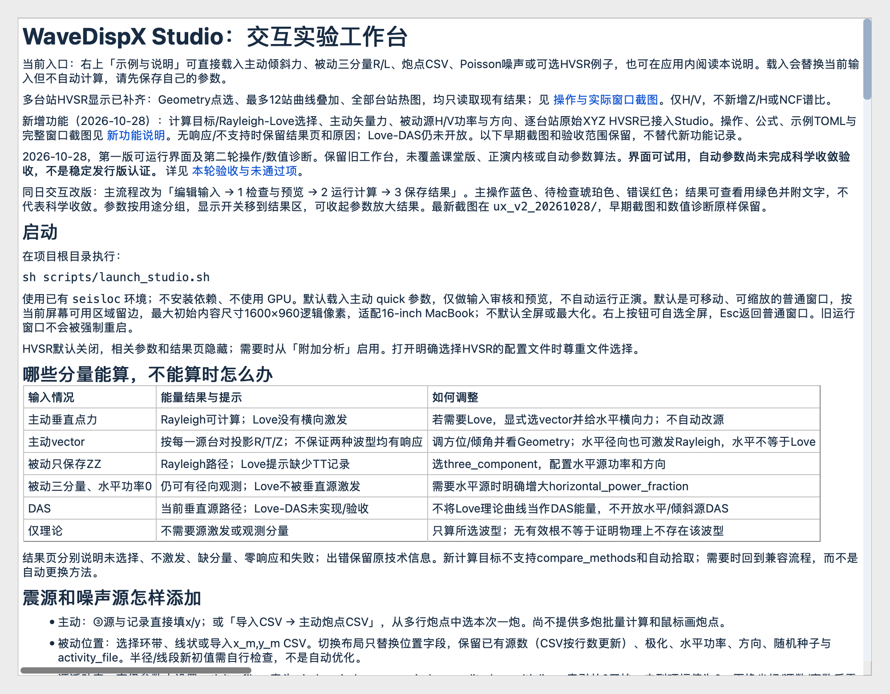
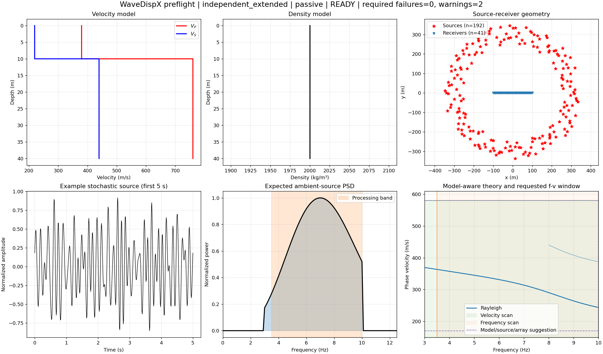
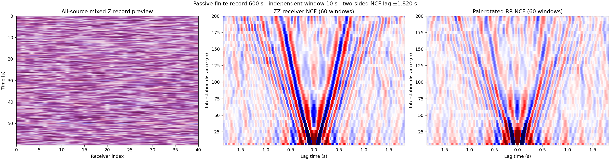
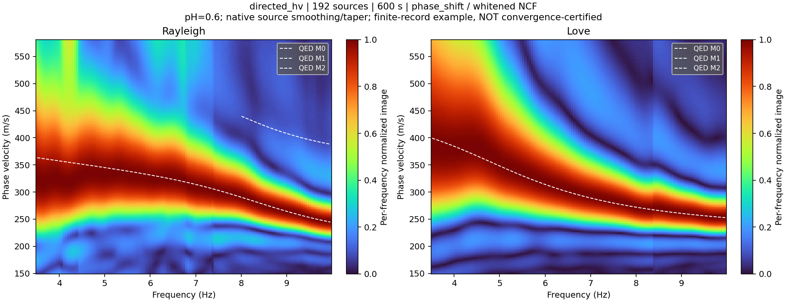

# 普通窗口、源输入修复与R/L实例

2026-10-28。本轮改动是界面、输入保留、错误指引和示例组织；不改正演核、噪声统计定义、NCF、成像或QED算法。

## 操作改进

- 默认普通窗口，既不全屏也不最大化。按当前屏幕可用区域留边，初始上限1600×960逻辑像素；本机两次实测1600×922和1600×924（随可用区域变化）。保留标题栏，可移动/缩放。全屏只作为用户可选按钮，Esc返回普通窗口。
- 右上「示例与说明」直接载入主动倾斜矢量、被动三分量R/L、主动炮点CSV、被动位置/Poisson或可选HVSR实例，并可在应用内读操作说明。
- 修复源环、源线、噪声源CSV三条入口重建整个ambient_sources表的问题：只替换位置字段，保留极化、水平功率、方向、活动文件和空间种子。源环不再擅自把已有源数提高到192；CSV仍按行数更新count。活动表按source_index对应输入行，不自动重映射；更换坐标后界面明确提醒核对。
- 新增中文错误定位和修改建议：H/V极化组合、独立源/时间模型、力方向、DAS限制、activity_file、HVSR和多成像方法限制。保留原始技术错误。
- HVSR默认关闭；新被动R/L示例明确使用energy_theory，没有HVSR计算或结果页。

## 普通窗口实际运行

以下为真实Qt窗口客户区截图（不含系统标题栏）；窗口状态normal和尺寸保存在[UI_PRODUCTS.json](ui_verified_final/UI_PRODUCTS.json)，不是全屏图片冒充普通窗口。

参数区可滚动；截图不声称全部高级字段同时展开。可用「收起参数」扩大结果区。所有Qt截图是实际CPU按钮/后台任务运行，不宣称computer-use逐按钮验收。

## 被动较长记录：模型、输入、NCF及两种波型

固定两层模型：10m覆盖层，Vp/Vs=380/220与760/440m/s，rho均2000kg/m³，Q无限；41接收器沿−100至100m、间距5m。环源250–350m，空间种子42、时间种子314159；平稳高斯Ricker PSD峰7Hz、3–10Hz，dt=.01s、独立窗10s，源水平总PSD占比.6。频散扫描3.5–10Hz、150–580m/s、dv2m/s，谱白化NCF/phase_shift，实际频率轴存数组。保留原生源平滑、频率窗及距离taper=.5；没有额外绘图平滑、理论掩膜或伪造能量。

三例实际完成：24源60秒independent_hv；192源600秒independent_hv；192源600秒directed_hv（统一方位45°）。后二例用于补齐两种极化的R/L实际展示；源数、时长同时变化，不作为单因素时长收敛对照。**仍有低频宽峰、旁瓣和窗间随机性，未认证统计/数值收敛。** 每张能量图逐频归一化，不能由色标比较两种波型绝对功率。

此预览沿用已有波形图：原始Z记录预览与ZZ/RR NCF；TT相关数组也在服务器保存，但此三栏图未显示TT。

无理论覆盖版：[独立H/V](passive_results/independent_extended_energy.png)、[定向H/V](passive_results/directed_extended_energy.png)。完整三例报告、实际时长和输入/代码/二进制/原数组哈希见[report.json](passive_results/report.json)。服务器核与本机experiment.py版本一致；不把同算法运行或图像连续当作独立物理验证。

## 验证及复现

- 修复前布局/CSV保留测试3项均因polarization丢失失败，窗口测试因缺少普通窗口入口失败；修复后相关6个测试文件67 passed in 34.65s。测试文件：test_studio_ux、test_studio、test_app_service、test_source_products、test_desktop、test_hvsr_view。
- 实际Qt计算覆盖倾斜主动R/L、垂直源无Love、仅Love理论和被动R/L；绘图前后能量数组哈希不变，结果及代码散列见ui_verified_final/UI_PRODUCTS.json。
- 初次UI脚本的被动计算超过90s。直接调用本机同输入约1.4s；栈显示工作线程停留在passive.py插值、主线程反复QTest.qWait。将测试脚本等待改为正常QEventLoop后，同一Qt被动计算约1秒。没有为此改生产正演或线程默认。ui_final、ui_runtime_check、ui_runtime_check_v2保留失败调试过程，不作为最终验收图。
- 仍记录隐藏/较小画布constrained_layout警告与macOS IMK日志；最终可见图已逐图检查，不声称日志零警告。
- 12张服务器QC图及report.json回传逐文件SHA256一致，报告SHA256=b8c94688e05cd79a4afa1d95ba842b743ccabe0aa4f05b32dfde8c7d39c412bd。大型原始结果留服务器，没有下载完整波形。

服务器位置：`lx_lzf:/storage/HOME/yaolab/liuxin/wavedispx_classroom_build_20261027/studio_products_20261028/passive_vector_energy_20261028_v1/`。使用该项目已有Linux CPU核与QED；Python为已有disba环境。复现脚本`scripts/check_passive_vector_energy.py --template examples/passive_vector_energy_studio.toml --output NEW_DIRECTORY`，设置OPENBLAS_NUM_THREADS=1、OMP_NUM_THREADS=4、PYTHONPATH=python_src和现有QEDISPINV_FORWARD路径。输出目录必须新建；不能覆盖原结果。

本机窗口验收：`PYTHONPATH=python_src conda run --no-capture-output -n seisloc python scripts/check_studio_products_ui.py --skip-hvsr --output NEW_DIRECTORY`。日常启动仍为`sh scripts/launch_studio.sh`。

未新增依赖、未推送GitHub、未打包发布；旧用户窗口未关闭。本轮没有实现Love-DAS、逐源方向目录、多炮批量、强制取消或通用收敛保证。
